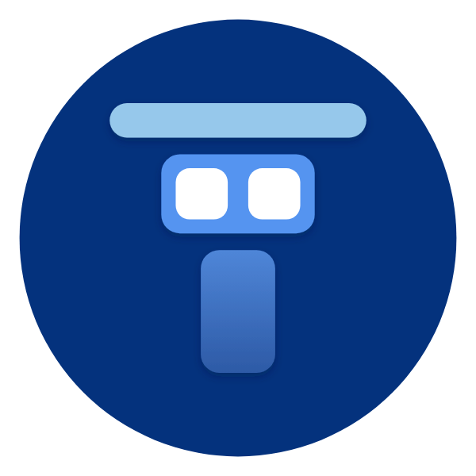

<div align="center">

<p align="center">
  <a href="https://keepandroidopen.org/" target="_blank">
    
  </a>
</p>



# Telos Launcher

**A search-focused, free and open source Android launcher with a set of built-in apps.**

Telos is a personal fork of [Kvaesitso](https://github.com/MM2-0/Kvaesitso). It keeps everything the original launcher does and adds a phone app, messages, a file manager, a gallery, music, video and radio players, an app store and an app freezer.

[](LICENSE.txt)
[](https://github.com/koukomin/Telos-Launcher/releases)
[](https://github.com/koukomin/Telos-Launcher/releases)

<p align="center">
  <a href="https://obtainium.imranr.dev/add?url=https://github.com/koukomin/Telos-Launcher">
    
  </a>
  &nbsp;&nbsp;
  <a href="https://github.com/koukomin/Telos-Launcher/releases">
    
  </a>
</p>

[**Documentation**](https://koukomin.github.io/Telos-Launcher/) &nbsp;|&nbsp; [**Download**](https://github.com/koukomin/Telos-Launcher/releases) &nbsp;|&nbsp; [**The launcher**](https://koukomin.github.io/Telos-Launcher/docs/user-guide/telos/launcher/) &nbsp;|&nbsp; [**Built-in apps**](https://koukomin.github.io/Telos-Launcher/docs/user-guide/telos/) &nbsp;|&nbsp; [**Changelog**](CHANGELOG.md)

The documentation site is published via GitHub Pages at <https://koukomin.github.io/Telos-Launcher/>.

</div>

> **Note:** The Telos apps use flat Material icons: a white glyph on an intense, saturated background of its own
> (navy for Phone, teal for Messages, amber for Files, slate for Calculator, blue for Screenshot, orange for Screen Recorder, cyan for Voice Recorder, amber for Notes, blue for Calendar, deep purple for Downloads, deep emerald green for Network, purple for Music, red for
> Video, green for Radio, orange for Camera). Telos Store uses the launcher icon. The name and the final branding are
> still in progress.

## Contents

- [The story behind Telos](#the-story-behind-telos)
- [What is Telos](#what-is-telos)
- [Download](#download)
- [The launcher](#the-launcher)
- [The built-in apps](#the-built-in-apps)
- [Languages](#languages)
- [Honest status](#honest-status)
- [Planned](#planned)
- [Build](#build)
- [Contributing](#contributing)
- [Credits](#credits) and [Projects Telos is based on](#projects-telos-is-based-on)
- [License](#license)

## Development screenshots

30 captures from a clean Pixel 7 emulator (Android API 35, x86_64 debug), in English with a dark wallpaper and shared blur, covering the launcher, built-in apps and Settings. No personal accounts. These show the development UI; they do not validate live playback or account sync.

[View the gallery](docs/docs/user-guide/telos/screenshots.md). The gallery includes WebP previews at the captured dimensions, source metadata and a link to the original PNG artifact.

Πραγματικές λήψεις από καθαρό emulator με development build, χωρίς προσωπικούς λογαριασμούς. [Συλλογή screenshots](docs/docs/user-guide/telos/screenshots.md).

## The story behind Telos

Telos started as a personal project, and I want to be upfront about how it was made: **I built it with zero coding knowledge.** The development has been done with AI assistants — [ChatGPT](https://chatgpt.com), [Claude](https://claude.ai), Grok and Gemini. I couldn't have written this software by hand. What I could do was describe what I wanted, test each build on my own phone, and keep iterating with the AI until it worked. In that sense Telos is as much an experiment in AI-assisted development as it is a launcher.

It all comes down to one missing feature. I was already a happy user of [Kvaesitso](https://github.com/MM2-0/Kvaesitso), which I think is an excellent launcher. But a few things I really wanted weren't there — above all **freezing apps and launching frozen apps straight from the launcher.** For me that is the single most important feature, for two reasons:

- **Battery.** A frozen app can't wake up, run in the background, sync or drain power. Freeze the apps you only open once in a while and the battery lasts noticeably longer.
- **Privacy.** A frozen app can't phone home, track you, or quietly listen in the background. (You know the feeling — you talk about something near your phone and suddenly see an ad for it? A frozen app simply isn't running. *Are you listening, Facebook?*) Being able to freeze an app and still open it on demand, right from the home screen, gives you the convenience without leaving it running all day.

Once that worked, I kept going. I started adding the things I use every day — a dialer, messaging, a file manager, a gallery, music, video, radio, downloads, a firewall and more — not as separate apps you install, but as **virtual apps built into the launcher itself.** Little by little the project grew, and at some point it stopped feeling like "a launcher with a few extras" and started feeling like something closer to a small **operating system on top of Android**: one place that does most of what I need a phone to do, built around my own priorities of speed, battery and privacy.

Telos is still a personal fork and a work in progress, shaped by what one person actually wanted from their phone. If any of that resonates with you, you're welcome to use it.


## What is Telos

Telos has two parts. **The launcher** is search, home screen, widgets, icons and themes, inherited from
Kvaesitso and extended by Telos. **The built-in apps** are *virtual apps*: they are not separate APKs, their
code is part of the launcher and runs inside the launcher process (the video player can optionally run in
its own process). Each app has an icon in the app grid, shows up in search, and can be switched on and off
from Telos Store.

| Part | What it is | Docs |
| --- | --- | --- |
| **The launcher** | Unified search, home screen, widgets, favorites and tags, themes, plugins, desktop mode, overlays, protection | [Launcher](https://koukomin.github.io/Telos-Launcher/docs/user-guide/telos/launcher/) |
| **Telos Phone** | Dialer, recents, contacts, dual SIM, call recording (VOICE_CALL first, silence retry, Shizuku/root CAPTURE_AUDIO_OUTPUT), call screening (prefix/regex/outgoing, max priority), SIP | [Phone](https://koukomin.github.io/Telos-Launcher/docs/user-guide/telos/phone/) |
| **Telos Messages** | SMS and MMS conversations, default SMS app, scheduled messages | [Messages](https://koukomin.github.io/Telos-Launcher/docs/user-guide/telos/messages/) |
| **Telos Files** | File manager: local/USB/remote space, ISO and zip folders, RAW/HEIC/HEVC previews, SMB by name or IP, archives, Cryptomator vaults, SSH key generation, Shizuku access, search across all storage, direct network music playback | [Files](https://koukomin.github.io/Telos-Launcher/docs/user-guide/telos/files/) |
| **Telos Screenshot** | Full, partial and scrolling screenshots with an editor and multi-select sharing from its gallery | [Screenshot](https://koukomin.github.io/Telos-Launcher/docs/user-guide/telos/screenshot/) |
| **Telos Screen Recorder** | Screen to video with microphone, pause, countdown and multi-select recording sharing | [Screen Recorder](https://koukomin.github.io/Telos-Launcher/docs/user-guide/telos/screen-recorder/) |
| **Telos Notes** | Notes with labels, sync with a Markdown folder or Nextcloud Notes, Keep and Evernote import | [Notes](https://koukomin.github.io/Telos-Launcher/docs/user-guide/telos/notes/) |
| **Ermis** | Native IMAP/SMTP email with verified TLS, full-screen reading/composition, passive offline HTML with a bounded resident mail cache, existing folders and safe moves, bounded recent server search, reply-all, original-message forwarding, encrypted local drafts, Cc/Bcc, device contact picking, multiple accounts, conversations, attachments, notes and optional Google/microG account consent (provider dependent; not Gmail feature parity) | [Ermis](https://koukomin.github.io/Telos-Launcher/docs/user-guide/telos/ermis/) |
| **Telos Calendar** | Month and agenda calendar, local calendar, Google and CalDAV through the system | [Calendar](https://koukomin.github.io/Telos-Launcher/docs/user-guide/telos/calendar/) |
| **Telos System** | CPU, RAM, IPs, processes, saved Wi-Fi manager (passwords, QR, notes, import/export, connect/forget; auto-detects Shizuku/root) | — |
| **Telos Downloads** | Download manager: several connections per file, resume, queue, retry, folder of your choice, torrents and magnet links with file selection, seeding and IP block lists, video and audio sites through yt-dlp (optional build), schedule, backup | [Downloads](https://koukomin.github.io/Telos-Launcher/docs/user-guide/telos/downloads/) |
| **Telos Network** | VPN based firewall and DNS filter on the Rethink engine: DNS servers, NextDNS profile analytics and logs, allow/deny lists, DNS rewrites and boolean settings, optional Android system Private DNS with a Quick Settings toggle and exact-SSID Wi-Fi rules via Shizuku, firewall per app and connection type, blocklists with exceptions, WireGuard per app, logs, privacy-minded LibreSpeed test using a chosen community or self-hosted server. Off until you turn it on, early version | [Network](https://koukomin.github.io/Telos-Launcher/docs/user-guide/telos/network/) |
| **Telos Voice Recorder** | Voice recordings with search, pause, call recordings and multi-select sharing | [Voice Recorder](https://koukomin.github.io/Telos-Launcher/docs/user-guide/telos/voice-recorder/) |
| **Telos Camera** | Native photo/video camera with capability-based controls, RAW, manual panorama and explicit LAN webcam | [Camera](https://koukomin.github.io/Telos-Launcher/docs/user-guide/telos/camera/) |
| **Telos Calculator** | Standard and scientific calculator, VAT, unit and currency converter, history | [Calculator](https://koukomin.github.io/Telos-Launcher/docs/user-guide/telos/calculator/) |
| **Telos Viewer** | Two tabs: **Photos** (gallery, immersive viewer, EXIF, editor, multi-file sharing) and **Documents** (PDF highlight, comics, SVG/PSD/AI/CDR, Office/OpenDocument/text/EPUB, PDF tools, multi-file sharing) | [Viewer](https://koukomin.github.io/Telos-Launcher/docs/user-guide/telos/photos/) |
| **Telos Media** | Music, Radio, YouTube Music, local Video, YouTube, TV and **Stremio Fork** in one app: **Listen / Watch / Live** tabs with source chips (the last source is remembered), one mini player above the bar, brightness/volume bars on video and TV, home-screen media metadata and controls for built-in playback as well as external players, the older apps open inside it, **TV** with live channels from iptv-org (country, language and category filters, favorites, recents, your own channels and M3U import, automatic failover to another or updated stream, optional extra Greek playlists and a Greek programme guide with now/next, favorites-first home with Browse and localized categories, optional background playback with a notification, automatic reconnecting when the connection is lost, and animated TV static for channels that are offline; **Stremio Fork**: Telos' own client for Stremio add-ons, written from the public add-on protocol, with add-on management and a directory of add-ons, catalogs, search, detail pages with episodes, a stream list (web, torrent with the file an add-on names, YouTube), subtitles from add-ons, a library and continue watching, Stremio account sign-in shown on entry, a separate account panel with sign-out, account sync (unofficial) for add-ons, library and continue watching, watched marks on movies and episodes from Stremio and the connected Trakt account, no add-ons or content included and not affiliated with Stremio), music and radio pause while a video plays, Share from long-press menus (songs, albums, videos, radio stations with a Telos import link, contacts, notes, files, documents, installed APKs); file shares from Files, Viewer, Media and Screenshot use the shared share/grant handling | [Media](https://koukomin.github.io/Telos-Launcher/docs/user-guide/telos/media/) |
| **Telos Music** | Local library with a Home tab (genre chips, quick picks, shelves), artwork-tinted Now Playing, sharing, lyrics, scrobbling, tag editor; Media3 plus official NextLib FFmpeg decoders | [Music](https://koukomin.github.io/Telos-Launcher/docs/user-guide/telos/music/) |
| **Telos Video** | Library, player, web streams, torrents, subtitles, Trakt; Media3 plus official NextLib FFmpeg decoders (AC3, DTS, TrueHD) inside Telos | [Video](https://koukomin.github.io/Telos-Launcher/docs/user-guide/telos/video/) |
| **Telos Radio** | Internet radio with station search, sleep timer and stream recording; Media3 plus official NextLib FFmpeg decoders | [Radio](https://koukomin.github.io/Telos-Launcher/docs/user-guide/telos/radio/) |
| **Telos Store** | Install and update apps from GitHub, F-Droid and more, manages the Telos apps, and lists Play Store apps when Play is installed. Opening Store with Play installed goes to Play updates, scans, and **Unfreeze and update in Play Store** thaws frozen apps, can block their network, and opens Play on the updates list | [Store](https://koukomin.github.io/Telos-Launcher/docs/user-guide/telos/store/) |
| **Smart Freeze** | Freeze or hide apps through Shizuku, root, device owner or Island (a launcher feature in Settings, not a Telos app) | [Smart Freeze](https://koukomin.github.io/Telos-Launcher/docs/user-guide/telos/freeze/) |

Telos Phone now reads the full Android contact list across synced accounts, including email-only contacts, rather than seeding its directory only from phone-number rows.

Built-in apps display short localized names such as **Phone / Τηλέφωνο** and **Files / Αρχεία**, without the Telos prefix. Searching `telos` still finds them, and English/Greek aliases work independently of the display language. Stable virtual keys preserve dock/favorites/gesture entries. Built-in artwork takes priority over generated icon-pack fallbacks; explicit user-selected icons remain supported. Recents use explicit icon resources that survive release shrinking. Virtual entries keep their own internal launch routes; frozen-package recovery only applies to real Android applications.

### Contacts, Media, home and Terminal updates

- **Contacts and Phone:** edit through the Android contact editor, explicitly confirmed deletion, persistent all/selected-account filters, account membership in duplicate-contact groups and live contact photos in recent calls. The large dialer heading is removed; search and menu share the top row.
- **Compact Media:** one source/action toolbar replaces stacked source chips and headings; labeled overflow actions and scrolling category tabs leave more space for media and large fonts. TV uses horizontal channel swipes, wrapping now/next programme details and independent Greek playlist fallback when the main catalog is unavailable. Local Video, Music, Radio, TV, YouTube and YouTube Music share one Media3 player stack with official NextLib FFmpeg software decoders from Maven; playback stays in Telos. Telos Viewer (photos and documents) stays built into the launcher.
- **Home glass and System widget:** Appearance exposes drawer blur and opacity directly. Built-in widget cards use wallpaper glass by default, with a switch, and the sidebar is slimmer. The Network widget is gone. The System widget (off in the picker until you enable it in Telos System) shows RAM used of total, storage used of total plus free space, opaque Vulkan/OpenGL buttons for the live renderer, LAN IP, public online IP, VPN tunnel IP, VPN state and device traffic. Tap RAM to open an installed task killer/booster (or Telos System). Tap storage to open Telos disk cleanup. Vulkan/OpenGL can be switched from the widget when that option is on in Settings → Advanced. The clock weather row is larger, uses vivid animated icons, and opens the weather app.
- **Termux:** install and update the official separate app from Store → Recommended → Tools. No terminal runtime or bootstrap downloader is bundled in Telos.

### Installer, dock, drawer and GIF wallpaper updates

- Store settings offer Android session installation (default), Shizuku, root and installed external APK handlers such as Thor. Privileged installs use explicit create/write/commit sessions with bounded stdin streaming and abandon failed sessions. External handoff requires confirmation; only the installed version determines success.
- Privileged frozen-app updates retain a recovery snapshot and install directly without requiring a successful thaw first. The Android-session/external path temporarily thaws with an authorized freeze backend and restores after its result. Cross-profile and third-party policy restrictions still apply.
- Dock apps use fresh launcher activities after thawing; frozen styling and snowflake badges are omitted in the dock while other badges remain available. Optional foreground-app freeze protection is **off by default** and requires Usage access when enabled.
- Drawer background tint/opacity and blur are independently adjustable. Fresh installs start with a soft-glass preset (35% tint, 32 dp blur), inspired by modern OEM launchers, not a measured copy of OnePlus. Tablet drawers use the available full width.
- Animated GIF wallpapers use the existing live-wallpaper activation and battery/thermal/visibility controls. Choose **Animated GIF wallpaper** in wallpaper settings. One GIF is animated at a time, with a 32 MiB input and 4-megapixel source limit; video playlist and playback-speed controls remain video features.

### Recent Media and Store improvements

- Greek TV supplements use iptv-org's Greece playlist (GitHub Pages), Free-TV and greektvm3u. National channels (ERT, ANT1, MEGA, SKAI, Star, Alpha, Open) are listed first. The 1990s closed SkaiTV.gr catalog id does not hide live SKAI.
- Torrent startup and buffering show live peers, seeds, download speed, responding/error trackers, DHT nodes and elapsed time, for both Video and Stremio Fork.
- Store downloads stream APKs to disk with progress/speed, pause/resume and automatic retry after a network interruption. Validated HTTP Range resumes partial files; servers without safe range support restart the transfer. Partial files survive cancellation and can be resumed by requesting the download again.
- Store filters are in a compact button/dialog. Update checks discover supported non-Play installs using known recommended sources, F-Droid and IzzyOnDroid. Discovered apps start with automatic updates off; individual/bulk Update offers opt-in for the selected apps. Silent automatic installation requires authorized Shizuku, root or Telos configured as device owner; plain device-admin access is insufficient.
- Large HTTP responses are no longer buffered in memory during APK downloads. Source text has a size limit; custom F-Droid indexes are parsed as a stream.

The new Media, Store and Files UI strings include Greek and English plus all supported base locales. Android XML, placeholders and changed-string coverage are checked in CI.

### YouTube in Telos Media

Telos YouTube and Telos YouTube Music provide video/music search, direct video links and a shared native Media3 background player. The Media hub groups local music, radio and YouTube Music under Listen; local video and YouTube under Video, alongside TV and Stremio Fork. Launcher search suggests both YouTube features with distinct Telos icons. Selected link parsing, audio selection and the downloader adapter are adapted from [Flow](https://github.com/Flow-Tube/Flow), with [NewPipeExtractor](https://github.com/TeamNewPipe/NewPipeExtractor). This is a focused integration, not the entire Flow application. An optional [browser account panel](docs/docs/user-guide/telos/media/youtube-account.md) opens YouTube and YouTube Music in the same browser profile. The native player does not import browser accounts; native account integration remains unfinished.

### How the built-in apps work

- **They look like normal apps.** Each has an icon in the app grid and shows up in search. Apps opened separately also have their own name and icon in Android Recents, so Files and Media can be switched independently; reopening an app reuses its card. Apps embedded as launcher pages stay in the launcher.
- **They can be switched on and off.** In Telos Store "install" shows an app's icon and "remove" hides it. Telos Store itself cannot be removed.
- **Switched-off apps cost nothing.** For Radio, Music, Video and Viewer the services and screens are disabled, so they use no memory or CPU and are not offered in "Open with". Phone and Messages are never touched.
- **They are guarded against crashes.** Radio, Music, Video and Viewer are switched off automatically when they crash or hang twice within a day, with a notification that points to the Store. Installing the app again resets the counter. Phone and Messages are never switched off, because Android needs them.
- **They appear in the share menu**, each under its own name and icon and only while installed:

| Share target | Accepts |
| --- | --- |
| Telos Messages | text, pictures, videos, `sms:` links |
| Telos Viewer | pictures and documents |
| Telos Video | videos, magnet links, torrent files |
| Telos Store | `obtainium:` links |
| Telos Phone | `tel:` links |

## Download

Every successful build of the development branch is published automatically as a debug-signed
pre-release (testing only):

- [Latest dev builds (APK)](https://github.com/koukomin/Telos-Launcher/releases)

---

## The launcher

The launcher is built around one idea: **search is the main way to reach things**. Full reference:
[launcher docs](https://koukomin.github.io/Telos-Launcher/docs/user-guide/telos/launcher/). Everything the original Kvaesitso launcher does is kept
(see the [Kvaesitso documentation](https://kvaesitso.mm20.de)).

### What Telos adds to Kvaesitso

| Area | Added or changed |
| --- | --- |
| Home screen | Dock with custom slots and multiple docks, shutters, video wallpapers, up to four widget pages, folder covers, independent grids for home, search and dock |
| Widgets | Reminders, Freeze, Battery, Network, System and At a Glance widgets, widget stacks, linked notes |
| Search | Results for web apps, the Telos apps and frozen apps, a text-matching ranking with usage weights, optional agents (Grok, Claude, ChatGPT and others, off by default), voice input on the search bar |
| Overlays | Floating launcher, Dynamic Island, desktop mode, web apps panel, assistant mode, optional Telos edge gestures and recents |
| Automation | Context profiles |
| Protection | Settings lock, launcher lock, App Lock with intruder photos, crash guard, exception containment |
| Customization | Presets, font scale, extra icon shapes, more badge options, German and Greek translations |

### Search

One text field finds apps, contacts, events, files, places, articles and more, and it can also calculate,
convert units and offer quick actions. All search settings are in **Settings > Search**. Names, titles, tags
and custom names are matched; file contents, message texts and note bodies are not.

| Source | What it finds | Min. text | Online? | Default |
| --- | --- | --- | --- | --- |
| Apps | Installed apps of every profile (personal, work, private space) | 1 | No | On |
| Telos apps | Phone, Messages, Radio, Music, Video, Viewer, Files, Calculator, Screenshot, Screen Recorder, Voice Recorder, Notes, Calendar, Downloads, Store, while switched on. Also found by synonym keywords in English and Greek (for example `pdf`, `gallery`, `photos` or `έγγραφα` find Telos Viewer); the Store's Telos apps tab search uses the same keywords | 1 | No | On |
| Web apps | Web app shortcuts shown in the grid | 1 | No | On |
| Activity by component name | One app entry for a typed `package/class` | 1 | No | On |
| App shortcuts | Shortcuts that apps publish (needs Telos as default home app) | 3 | No | On |
| Contacts | Android contacts, plus contact plugins | 2 | No | On |
| Calendar | Events of the next 730 days, plus calendar plugins | 2 | No | On |
| Reminders | Tasks.org tasks and tasks from calendar plugins | 2 | No | Filter on, source off |
| Local files | Files from the Android media database | 2 | No | On |
| Nextcloud, ownCloud | Files on your own server | 4 | Yes | Off |
| Places | OpenStreetMap places near you, plus place plugins | 2 | Yes | On |
| Websites | A preview card for a URL you type | 1 | Yes | On |
| Wikipedia | One article | 4 | Yes | On |
| Calculator | The value of an expression | 1 | No | On |
| Unit converter | Units and currencies | 1 | Rates only | On |
| Tags and custom names | Saved items whose tag or custom name contains your text | 1 | No | Always |
| Quick actions | Chips next to the search bar | 1 | No | Nine on |

**Special queries**

| You type | You get |
| --- | --- |
| `0xFF`, `0b101`, `017`, `3,5 * 2` | Calculator: hex, binary and octal literals, comma as decimal separator, `;` as argument separator, binary/hex/octal shown for integers, scientific notation above 1e12 or below 1e-5 |
| `5 km`, `5 km >> mi`, `20 c > f` | Unit converter: `<number> <unit>` lists every unit of the dimension; `>>`, `>` or `-` picks one target |
| `package/class` | The activity with that component name |
| `example.org/path` | Website preview card (Online results) and an **Open website** chip |
| `+49 30 1234567` | **Call**, **Message**, **Add to contacts** chips |
| `name@example.org` | **Email** and **Add to contacts** chips |
| `16:39`, `2:20 am` | **Set alarm** chip |
| `30 s`, `11 min`, `2 h`, `3 d` | **Start timer** chip (24 hours or less); longer spans become a **Schedule event** |
| A date, or date and time in your phone's format | **Schedule event** chip |
| `Private space` | **Lock or unlock private space** chip (Android 15+, must be added) |
| `Work profile` | **Pause or resume work profile** chip (must be added) |
| Any text | **Web search** chip, plus **Share** if added |

Conversion units: length (m, km, dm, cm, mm, in, ft, yd, mi, nmi), mass (kg, g, t, st, lb, oz, long and short ton), area, volume (L, mL, m3, gallons, pints, fl oz, cup, tbsp, tsp and more), time (ms to years), data (B to TB, kiB to TiB, bits), speed (m/s, km/h, mph, kn), temperature (C, F, K) and ISO 4217 currencies.

<details>
<summary><b>Quick actions: twelve built-ins, custom web searches and intents</b></summary>

| Action | Shown when | Default |
| --- | --- | --- |
| Call | Phone number (opens the dialer) | On |
| Message | Phone number | On |
| Email | Email address | On |
| Add to contacts | Phone number or email | On |
| Set alarm | Time of day | On |
| Start timer | Time span up to 24 h | On |
| Schedule event | Date, date and time, or a span over a day | On |
| Open website | URL | On |
| Web search | Always | On |
| Share | Always | Off |
| Lock or unlock private space | "Private space" typed, Android 15+ | Off |
| Pause or resume work profile | "Work profile" typed | Off |

- Created in **Settings > Search > Quick actions**: add, drag to reorder, edit, delete; everything is part of the backup.
- **Search on a website:** URL template with `${1}`; the launcher tries to import name, icon and template from the site's OpenSearch description (built-in fallbacks: Google, Bing, Amazon, DuckDuckGo, Yahoo, Ecosia). **YouTube** and **Google Play** come pre-installed.
- **Search in an app** (experimental): apps that accept the standard search intent.
- **Custom intent:** action, category, type, data, package, class, extras; the query goes in as data or as a string extra.
- Quick actions are not affected by filters.

</details>

<details>
<summary><b>Ranking, groups, filters and the filter bar</b></summary>

**How a search runs.** Every enabled source that matches the active filters is queried in parallel; results appear as they arrive. Optional **Search delay** (Settings > Performance, 0 to 500 ms, off by default). Places wait 250 ms and Wikipedia 750 ms. Limits: local files 10 results (scan stops after 500 rows), contacts about 15, Nextcloud 10, five entries per group until **Show all**.

**Ranking:** `0.6 x match score + 0.4 x usage weight`.

- Match score: Jaro-Winkler plus prefix and substring bonus, capped at 1; a match on a secondary field counts 20 percent less. Apps need at least 0.8.
- Usage weight rises with each launch. **Ranking flexibility** sets the step: Stable 0.01, Balanced 0.03 (default), Variable 0.1.
- **Greek and Greeklish:** Greek matches with or without accents, in any case, and when typed with Latin letters (`kalimera`, `mpala`, `thelw`, `chartis`). Letters that sound alike are merged, so a few similar English words may match too. It covers apps, contacts, files, calendar, tags, notes and the Telos apps, but not results that a plugin searches itself.
- Text is lower-cased and accent-stripped; ae, oe and ss are expanded; a **transliterator** (Settings > Language and region) lets non-Latin names match Latin input.
- Places sort by distance when a location is cached. Quick actions keep their configured order. The empty-search drawer is alphabetical per profile (frozen apps can go last). Duplicates by item key are removed.

**Radio stations** (optional, off by default; Telos Radio and web videos also reconnect automatically when the connection to a stream is lost): favorite Telos Radio stations whose name matches show as results with their logo and a host/type line (same-name stations are all shown), and play with one tap; a play/pause button with a loading ring sits next to the name here and in the Radio station lists. **Group order, top to bottom:** favorites (empty query only), pending store updates, apps, web apps, app shortcuts, unit converter, calculator, events, reminders, contacts, places, Wikipedia, websites, files, documents, images, video, music, recommended app. **Arrangement of search results** can reverse it for a bottom search bar.

**Filters** (funnel button; a dot means one is active):

| Filter | Finds |
| --- | --- |
| Online results (switch) | Wikipedia, websites, places, cloud files, online plugin results |
| Apps, Contacts, Calendar, Reminders, App shortcuts | Their own sources |
| Files | Local and cloud files as one list |
| Documents, Images, Video, Music | Files by MIME type, one group each (alternative to Files) |
| Wikipedia, Websites, Places | Still need Online results |
| Tools | Calculator and unit converter |
| Hidden items (switch) | Shows excluded results again |

- With all categories on, tapping one selects only that one; tapping the only one turns all back on. A single active category starts expanded.
- Clearing the search or closing the drawer returns to your **default filter**.
- **Filter bar:** chips above the keyboard, on by default, up to 16 entries, drag to reorder, categories first, then a divider, then the two switches.

**Online results.** Network lookups only run with Online results on:

| Source | Sends | Minimum text |
| --- | --- | --- |
| Websites | The URL you typed, to that site (3 s timeout) | Any |
| Wikipedia | Your query, to the Wikipedia API | 4 characters |
| Places | Your query and area, to an Overpass server | 2 characters |
| Nextcloud, ownCloud | Your query, to your own server | 4 characters |
| Plugins | Whatever the plugin does | Set by the plugin |

If you switch online results on in the default filter, every query is sent to external web services, and Telos warns about that.

</details>

<details>
<summary><b>Result cards, per-source settings, search bar behavior, hidden results</b></summary>

- **Result cards:** apps (notifications, shortcuts, version and package, pin, app info, share link or APK, uninstall, shutter, freeze; with advanced freeze features also Clone to Sandbox, force stop, clear cache), shortcuts, contacts (numbers with call and message, emails, addresses, rows from other apps), events and tasks, files (metadata, open, share, delete for local files), places (map, opening hours, distance, dial, website, navigation, report a bug), websites, Wikipedia articles, calculator (long-press copies the number), unit converter, web apps. **Customize** sets a custom icon, label, tags and visibility.
- **Apps:** show all apps on empty search, show app information, list instead of grid, move or hide frozen apps, own search grid. With a work profile or private space the grid gets one tab per profile and a lock button (Telos must be the default home app).
- **Files:** local file types (documents, images, videos, music, other), excluded folders, Nextcloud, ownCloud, file plugins. A query of three characters or fewer matches the start of a file name only. Needs storage permission (all files access on Android 10+).
- **Contacts:** display, alternative, phonetic name and sort key; optional **tap to call**. **Calendar:** any synced account (including DAVx5 and Fossify Calendar), pick which calendars are searched. **Tasks:** Tasks.org.
- **Places:** OpenStreetMap, radius 500 m to 10 km (default 1500 m), map preview with theming, hide uncategorized places, own Overpass and tile server URLs, deduplicates places under 100 m apart.
- **Wikipedia:** URL can point to another language edition or MediaWiki site. **Unit converter:** preferred currencies listed first; rates from the European Central Bank daily file, refreshed hourly in the background.
- **Search bar behavior:** open keyboard, **launch on enter** (best match order: apps, shortcuts, events, reminders, places, contacts, Wikipedia, websites, files, then quick actions), private keyboard, search bar style transparent, solid or hidden, top or bottom, fixed bar, remember scroll position.
- **Hidden results:** per item **Show in** is app grid and search, search only, or never. Manage under Settings > Search > Excluded search results, optional reveal button (apps only, empty query only). Wikipedia, website and calculator results cannot be hidden.
- **Permissions per source:** a missing permission never crashes search; the group shows **Grant** and **Turn off**.
- **Plugin results:** contacts, files, places and calendar plugins; off until switched on, ranked, hidden, tagged and pinned like built-in results, marked by plugin badges.

</details>

**Not available or not honest to promise:** there is **no search history** (queries are never stored, only launch counts), **no hashtag queries** (tags are plain keywords; `#tag` is only how cards display them), no full-text search, texts about fuzzy initials, quick settings search and learning ranking have no code behind them, there is no Google Drive source, and the stored "separate work profile in results" setting is not read.

Full catalogue: [Search: complete feature catalogue](https://koukomin.github.io/Telos-Launcher/docs/user-guide/telos/launcher/features/search-catalogue).

### Home screen

A clock, a search bar, an optional dock and, if you want them, widgets. Settings are in **Settings > Home screen**, **Appearance**, **Gestures** and **Grid and icons**.

| Piece | What it is | Default |
| --- | --- | --- |
| Clock | Top element with a dynamic zone, never removable (style can be "No clock") | On, Bold |
| Widgets page | Scrollable widget list, up to four pages | Swipe up |
| Search / app drawer | Search view with apps and favorites | Swipe down or tap the bar |
| Dock | Row or grid of apps and widgets above the search bar | Seeded once with default apps |
| Search bar | Transparent, solid or hidden; top or bottom | Bottom, transparent |
| Web apps panel | A page for web apps | Swipe right |
| Widgets on home screen | Puts widget page 1 under the clock | Off |

<details>
<summary><b>Clock: layouts, eight styles, colors, dynamic zone</b></summary>

- **Layout:** Default (vertical) or Compact (clock and dynamic zone side by side). Long-press the clock for its sheet; tapping opens the alarm list.
- **Styles:** Bold (optional outline), Simple, Orbit, Hands (analog, optional ticks), 7-segment, Binary, No clock, Custom widget (any Android widget).
- **Options:** Auto, Dark or Light content, theme color, seconds, monospaced digits (Bold, Simple, Orbit), fill screen height, alignment top, center or bottom, 12 or 24 hour format.
- **Dynamic zone** shows one item at a time, the most relevant: Date (primary and optional secondary calendar), Weather, Media controls, Alarms in the next 8 hours, Battery (off, when low or charging, always), or **Smartspacer** targets (non-release builds).

</details>

<details>
<summary><b>Dock, search bar, wallpapers (including video), system bars</b></summary>

- **Dock:** seeded once on first start with the device's default apps. **Custom dock** slots hold an app or a widget; 1 to 4 rows, 1 to 10 columns (1 x 5 default); **multiple docks** (up to 5, swipe to switch, default dock choice); own grid (3 to 12 columns, 32 to 64 dp icons); background plate (color, opacity default 30 percent, shadow); page indicator; **shutters** (swipe up on a dock icon to launch a second app, activity or shortcut). Dock icons are always circles.
- **Search bar:** transparent, solid or hidden with live preview, light or dark content, separate colors while the drawer is open, top or bottom, fixed bar, remember scroll position. The menu button offers Wallpaper, Settings, Add widget, Help; with text it clears the field.
- **Wallpaper** (Appearance): photo or video, system wallpaper picker, dim for dark theme, cached wallpaper blur for the drawer, widget cards and Telos apps; static home images must be set inside Telos. Live/external wallpapers use a translucent tint.
- **Video wallpaper** (experimental): a playlist of videos; scaling Fit, Fill or Stretch; brightness 0 to 2; zoom 0.5 to 5; position; speed 0.25 to 3; start behavior Resume, Restart or Random frame; parallax with strength; stored option for theme colors from the video; pause in Battery Saver (on), on thermal throttling (on) and in desktop mode (off).
- **Other:** lock desktop, fixed portrait rotation, charging animation (bubbles from the navigation bar), status and navigation bar icon color auto, light or dark, hide status bar, hide navigation bar, **Create folder** (two or more apps) and folder covers, edit button.

</details>

<details>
<summary><b>Gestures: 11 gestures and every action</b></summary>

| Gesture | Default action |
| --- | --- |
| Swipe down | Search / app drawer |
| Swipe up | Widgets (page 1) |
| Swipe right | Web Apps Panel |
| Swipe left, pinch in, pinch out, two-finger swipe up, two-finger swipe down, home button | Do nothing |
| Double tap | Turn off screen |
| Long press | Home screen menu (change wallpaper, add widget) |

- **Actions:** open any built-in Telos app (Phone, Messages, Notes, Calendar, ...) directly from a gesture, or show most of them as a page inside the launcher (all except the Store), do nothing, search / app drawer, widget pages 1 to 4, Feed (non-release builds), Web Apps Panel, home screen menu, notifications, quick settings, turn off screen, power menu, recent apps, launch an app, shortcut or any searchable item, launcher settings, plugin actions.
- Turn off screen (Android 9+), power menu and recent apps need the launcher's accessibility service; a banner and a "gesture failed" sheet guide you.
- Only swipes, double tap and long press can be overridden by a context profile. Tapping the search bar always opens search.
- Optional **Telos navigation** (off): edge strips for Back, Home and Recents, and a Telos recents list. Needs the accessibility service.
- Optional **agents** in search (off): an Ask chip for Grok, Claude, ChatGPT, Gemini or Copilot. Voice input on the search bar is on by default. Hardware keyboard: Super+Space search, Super+Enter Terminal, Super+1 home.

</details>

**Honest notes:** extra home screens (the slider for up to nine pages) are **switched off** in this build by a compile-time constant, so there is exactly one home page plus four widget pages. Video wallpaper is experimental. The dock background blur value has no control. Status: [Honest status](#honest-status).

Full catalogue: [Home screen and appearance catalogue](https://koukomin.github.io/Telos-Launcher/docs/user-guide/telos/launcher/features/home-appearance-catalogue).

### Widgets and feed

Telos has built-in widgets, hosts any Android app widget and shows small widgets that a plugin provides.

| Widget | What it shows | Options |
| --- | --- | --- |
| At a Glance | One item: weather, next calendar event or battery state | none |
| Weather | Forecast of the selected provider | Compact mode |
| Calendar | Events of the day, previous and next day buttons | Hide completed tasks, per-calendar choice |
| Reminders | Tasks from the Tasks app | Hide completed tasks |
| Media | Playing media with controls | Interactive progress bar |
| Note | Free text, optionally linked to an existing or new external text file with conflict handling | Link to file |
| Battery | Charge state | none |
| Network | Connection type | none |
| System | RAM and storage usage | none |
| Freeze | Smart Freeze candidates, **Freeze now** button | none |
| Plugin widgets | Rows of title, subtitle and value from a widget plugin | none |
| Android widgets | Any app widget | Borderless, background card, theme color, configure, replace |

- **Layout:** four widget pages, optionally page 1 on the home screen, or a dock slot (only 1x1-fitting widgets). Edit widgets: add, drag to reorder, resize by height, **stack** (swipe between them, remove from stack), replace, remove.
- **Telos Phone** adds recent calls and direct call widgets. A **context profile** can switch which widget page the Widgets gesture opens.
- **Feed** (debug and nightly builds only): a content page from a separate overlay provider app (protocol version 7); **not available in release builds**, and the Google app and Lawnfeed are blocked in release builds.
- The Favorites widget is no longer offered; widgets added earlier keep working. Calendar widget extras (all-day switch, upcoming counts) and the reminders maximum are stored without a screen.

### Favorites, tags and hidden items

| Level | How you get it | Effect |
| --- | --- | --- |
| Not pinned, frequently used | Launch an item | Shown when there is room (rows 1 to 4) |
| Pinned, automatically sorted | **Pin to favorites** | Always shown, ordered by usage |
| Pinned, manually sorted | Drag in **Edit favorites** | Always shown, in your order |
| Pinned tag | Edit favorites > Tags | Works as a folder |

- Anything saveable can be pinned: apps, contacts, files, events, shortcuts, places, websites, web apps, plugin results. Favorites show above the app grid, in the dock, in the clock's dynamic zone; pinned events show in the calendar widget.
- Settings: favorites on or off, edit button, frequently used on or off, number of rows, compact tags, **Ranking flexibility** (Stable, Balanced, Variable).
- **Tags** are plain words attached to items: search keywords and, when pinned, folders. Create, rename, change icon or emoji, duplicate, delete; renaming to an existing name merges. Tags do not nest.
- **Auto-organize** groups installed apps into tags named after their Android category. It does not run by itself, skips categories with fewer than two apps, and replaces the contents of a tag of the same name.
- **Hidden items:** **Show in** per item (grid and search, search only, never), listed in Settings > Search > Excluded search results, optional reveal button, **Hidden items** filter.
- Pinned items, usage weights, visibility, custom names, icons and tags are part of the backup.

Full catalogue: [System catalogue](https://koukomin.github.io/Telos-Launcher/docs/user-guide/telos/launcher/features/system-catalogue#favorites).

### Customization

- **Adaptive UI foundations:** launcher/search measurements follow the active window; shared
  settings and navigation labels grow with text, and selected app grids/panes reflow or scroll
  when space is insufficient. See the [implemented scope and UI contract](docs/docs/developer-guide/adaptive-ui.md)
  and [validation record](docs/docs/developer-guide/ui-validation.md) for checks and device-review limits.

- **Wallpaper readability:** Wallpaper settings offer Automatic, White and Black text. The clock,
  home labels, transparent search bar and widget backings use protective scrims when pixels are
  unavailable or mixed. Local contrast sampling is limited to permitted, uncropped static wallpapers
  on Android 8.1–12 with blur/dimming off; Android 13+ and live wallpapers use the safe fallback.
  Default shared panel opacity is 80%; saved custom transparency values and explicit clock/label
  colors remain respected. Third-party widget content and explicitly theme-colored clock faces may
  control their own colors. See [readability details](docs/docs/user-guide/customization/color-schemes.md#wallpaper-readability).


<details>
<summary><b>Themes, presets, fonts, blur, grid, icons, badges, motion, per-item changes, language</b></summary>

- **Theme:** system, light, dark or **time of day** (default 20:00 and 07:00 clock hours), text size 80 to 200 percent, dynamic color source, theme import and export as `.kvtheme` files (opening a theme file from another app starts the import).
- **Color schemes:** Default (Material You on Android 12+), High contrast, Black and white, or your own: six core palette colors with separate light and dark roles.
- **Fonts (typography):** Default, System, Monospace, Serif, Rounded, or custom with a brand and a plain font and a style per text role.
- **Shapes:** Default, Extra round, Cut, Rectangular, or custom. **Transparency:** Default, Semi-transparent, or custom opacity of background, surface and elevated surface.
- **Blur and surfaces:** wallpaper blur (radius 4 to 64), drawer background plate (default 35 percent), dock plate, folder background color.
- **Presets** (applied at once, no confirmation, no undo): **Telos** (glass transparencies, transparent search bar, drawer blur and glass widgets), AMOLED Black, AMOLED Red / Green / Yellow / Light Blue / Magenta / Orange (pure black, accent, white type) and Cyberpunk (colors), Colorful Grid (colors and layout), Classic Grid, Clean Grid, Pixel-style (layout). A layout preset overwrites grid, icon shape, dock and search bar settings. Fresh installs already use the Telos glass values. Virtual apps (Store, Media, Notes, Calendar, Files, Network, Comms, and the rest) follow the same transparency and drawer blur.
- **Grid:** 3 to 12 columns (5 default), icon size 32 to 64 dp, labels (size 8 to 24, one or two lines, shadow, color), apps as a list, separate overrides for home and search grids, folders and folder covers.
- **Icons:** shapes (Platform default, Circle, Square, Rounded square, Squircle, Reuleaux triangle, Hexagon, Pentagon, Teardrop, Pebble), enforce shape, themed icons, enforce themed icons, one **icon pack** (appfilter and grayscale-map formats, live calendar and clock icons), icon cache size 50 to 500.
- **Badges:** notification badges (dot or count, color), cloud, suspended or frozen apps, shortcut and plugin badges; work profile, hidden item and Store update badges are always on. Frozen apps follow the selected grayscale or snowflake style consistently in grids, lists, folders and the sidebar.
- **Motion:** charging animation, reduce animations, animation speed 0.5 to 2.0, bounce physics.
- **Per-item customization:** long-press and tap Customize for a new label (the original name still matches), icon (including icon pack, themed or text icon), tags, **Show in**, a shutter app, or web app settings.
- **Language and region:** 35 languages (see [Languages](https://koukomin.github.io/Telos-Launcher/docs/user-guide/telos/launcher/languages)), per-app language on Android 13+ (in-app language picker on older versions), form of address (for every language with feminine and masculine variants: Arabic, Belarusian, Catalan, Czech, Greek, Spanish, French, Hebrew, Hindi, Italian, Polish, Portuguese, Romanian, Russian, Ukrainian), transliteration, time format, measurement system, calendar systems, currency order.
- **Accessibility and comfort:** text size, high contrast and black and white schemes, reduce animations, label options, fixed rotation.
- **Limitation:** fallback icon packs are supported by the icon service but have **no setting**, so only a single icon pack is usable. Several other values are stored without a screen (Wikipedia images, dock background blur, legacy surface settings).

</details>

Full catalogue: [Home screen and appearance catalogue](https://koukomin.github.io/Telos-Launcher/docs/user-guide/telos/launcher/features/home-appearance-catalogue#themes-and-colors).

### Plugins and integrations

Integrations are under **Settings > Integrations**, plugins under **Settings > Advanced > Plugins**.

| Integration | Gives you | Needs |
| --- | --- | --- |
| Weather | Forecast for the weather widget, clock and At a Glance | Network, location |
| Media control | Now playing, play, pause, skip, seek when supported; choose which music apps count. Telos Music, Video and Radio are normal sessions | Notification access |
| Nextcloud, ownCloud | File search in your own cloud, cloud badge, sign-in and sign-out | Account |
| Wikipedia | Article results, configurable Wikipedia URL | Online results filter |
| Tasks | Tasks.org tasks in search and in the reminders widget | Tasks app and permission |
| Breezy Weather | Weather via the Gadgetbridge broadcast, set up in both apps | Breezy Weather installed |
| Smartspacer | Smartspacer targets in the clock's dynamic zone (Android 10+) | A non-release build |
| Feed | A content page from another app | A non-release build, a provider app |
| Cloud and network storage | Dropbox, Google Drive, OneDrive, WebDAV, SFTP, SMB, FTP for Telos Files | Per storage |

**Severe weather alerts** (off by default, Integrations > Weather): a notification when the stored forecast for the next 6 to 72 hours expects rain (chance of rain from a threshold), heavy rain, snow or sleet, thunderstorms or hail, high temperatures, frost, strong wind or a high UV index, with the strongest value, the start time and the place; each kind at most once in 12 hours, temperatures and speeds in your measurement system, a test notification. Forecasts, not official warnings.

**Weather providers:** Open-Meteo (default) and Bright Sky always; OpenWeatherMap and MET Norway only in builds that ship their keys; Breezy Weather when installed; any weather plugin. Automatic or manual location, measurement system (system, metric, UK, US).

**Plugins** are ordinary Android apps that expose a content provider through the plugin SDK. Telos does not run their code, so a plugin cannot crash the launcher. Enabling a plugin triggers a permission dialog where **Allow** stores Telos on the plugin's own allow list; other callers get a `SecurityException`. A plugin may report "Setup required" or an error, and cannot be switched on until it is ready. A check mark marks verified authors.

| Plugin type | What it adds |
| --- | --- |
| Files | Search results from a cloud or other file source |
| Places | Places and points of interest |
| Calendar | Events and tasks, with calendar lists |
| Contacts | Contacts |
| Weather | A weather provider ("Set as weather provider") |
| Gesture action | Named actions for Settings > Gestures |
| Widget | A small read-only list widget in the widget picker |

Plugins can store references (must work offline) or copies of saved items. Developers: see `docs/docs/developer-guide/plugins/`.

**Honest notes:** feed and Smartspacer are **not in release builds**; Breezy Weather and Smartspacer need their apps; cloud logins and plugin enable state are not part of the backup.

Full catalogue: [System catalogue](https://koukomin.github.io/Telos-Launcher/docs/user-guide/telos/launcher/features/system-catalogue#plugins).

### Backup and restore

**Settings > Advanced settings > Backup and restore** writes and reads a plain ZIP archive (not encrypted).

Backup and restore ask first **what** to include: **Launcher** (settings and the rest of the table), **Notes**, **Calendar** (the local calendars as `.ics`) and **Downloads** (download list and settings), each with a checkbox and an **All** button. On restore only the parts that the file contains are offered, and unticked parts are not touched.

| Included | Not included |
| --- | --- |
| Settings, favorites and saved items (usage weights, pin position, visibility), custom icons, labels and tags, widgets, quick actions, custom color, shape, transparency and typography themes, Telos Notes, local calendars of Telos Calendar, download list and settings of Telos Downloads (their own parts) | Cloud logins (Nextcloud, ownCloud, notes sync), calendars of accounts (the account has them), plugin enable state, wallpaper, icon packs, intruder photos, passwords and API keys of the Telos apps, hidden and protected call numbers, the custom lock PIN hash (a restore keeps the device's own PIN lock) |

- Restore wipes saved favorites first, then imports the file; secrets already on the device are kept. A SIP or phonebook account without a password after restore is switched off.
- A failed backup shows an error with **Try again**. If some parts of a restore fail, the other parts are still restored and a warning is shown.
- Format `1.11`: same version restores fully, a different minor version restores with a warning, a different major version is refused. Archive entries that would unpack outside the restore folder are ignored.

### Profiles

- **Personal, Work, Private and Dual/clone** profiles are recognized (private space on Android 15+; OEM Dual Apps such as Xiaomi user 999 as Clone). The Samsung Secure Folder is hidden. Apps get tabs per profile in the empty-search grid (clone copies stay on the main tab), work apps a briefcase badge, private apps a lock badge, dual apps a person badge.
- An explicitly enabled per-app rule can **unfreeze selected companions** before opening or unfreezing it (Gemini → Google, ReVanced/Morphe YouTube → microG, Play-licensed apps → Play Store, games you tie to a game booster). Those companions stay unfrozen until the master app is frozen again, including Freeze all and screen-off. Foreground, the app that was in front when the screen turned off, music and network-active apps are skipped by auto-freeze (foreground skip is on by default).
- **Sandbox** (experimental, pending review): **Initialize Telos Sandbox** starts managed profile provisioning with Telos as profile owner; **Clone to Sandbox** copies an app into the work profile. OEM dual apps (Viber, WhatsApp, …) also appear in the app drawer and in the Phone sidebar.
- **Context profiles** (experimental) are a different feature: named bundles of overrides (gestures, freeze profile, widget page, Do Not Disturb, brightness, launch an app) triggered manually, by time, WiFi name, Bluetooth device, Battery Saver or charging, checked only while the launcher is open. Details below.

### Permissions, assistant and global actions

| Permission or access | Used for |
| --- | --- |
| Calendar, Contacts, Location | Calendar search and widget, contact search, weather location, places distance, WiFi trigger |
| Tasks | Tasks.org integration |
| All files access | Local file search |
| Notification listener | Notification badges, media widget |
| Default home app role | App shortcuts, work profile pause, private space lock |
| Accessibility service | Screen off, power menu and recents gestures, App Lock detection (listens to window state only), screenshots and the swipes of the scrolling screenshot (Telos Screenshot) |
| Microphone | Telos Voice Recorder, the microphone of Telos Screen Recorder, call recording |
| Screen capture (asked every time) | Telos Screen Recorder |
| Phone, call log, phone state | Telos Phone, Dynamic Island call pill |
| Usage access | Smart Freeze idle detection, App Lock detection |
| Display over other apps | Floating launcher, Dynamic Island, App Lock overlay |
| Bluetooth connect, notification policy, write settings, camera | Context profile triggers and overrides, intruder photo |

- Permissions are asked only when a feature needs them. On Android 13+ accessibility and notification access can be blocked for apps installed outside a store; Telos shows guidance after the first attempt.
- **Default launcher:** Telos is a home app (`HOME`) and also handles pinned shortcuts, theme files and `obtainium://` links.
- **Assistant:** set Telos as the digital assistant and the assist gesture opens it in assistant mode.
- **Global actions** without root: notifications and quick settings (status bar service, accessibility fallback), screen lock, power menu and recents (accessibility). Telos Screenshot takes screenshots through the accessibility service (Android 11+ for its own pictures, the system action on Android 9 and 10); there is no gesture for it.
- Other: settings deep links, crash reporter and logs under Advanced > Debug (local only, nothing is sent; can be switched off, and all reports can be deleted), About with build information and open source libraries.

Full catalogue: [System catalogue](https://koukomin.github.io/Telos-Launcher/docs/user-guide/telos/launcher/features/system-catalogue).

### Desktop mode and overlays

Telos can draw things in other places than the home screen. Much of this is marked experimental and needs verifying on real hardware (see [Honest status](#honest-status)).

| Feature | Where | What it does |
| --- | --- | --- |
| Desktop mode | A connected external display | Desktop shell with a workspace grid, taskbar with a start menu, running-app dots, system tray and clock. Orientation, icon size and wallpaper settings. Switches itself on at the first display |
| Freeform windows | Whole device, via Shizuku | Snap left, snap right, maximize and close from the taskbar menu. Changes windowing for every app while on |
| Floating launcher (Smart Sidebar) | Over every app | A thin handle on the left or right edge that opens a card of your tools, apps and widgets, modeled on the Smart Sidebar of OxygenOS: File Dock on top, one or two columns, an All list of tools, an Edit tile that opens an editor with search (tools, widgets, apps, drag to reorder). Tools: screenshot, partial screenshot, scrolling screenshot, screen recorder, voice recorder, recent files, flashlight, quick settings, notifications, lock screen, power menu. Widgets of the launcher can be put in it. No AI Summary, AI Speak or Private Tab. Off by default, no search field in the card by design |
| Dynamic Island | Top of the screen | A pill showing the most relevant live item by priority: call, timer, media, charging |
| Web apps | Home screen and a panel | Websites as app-like shortcuts in an embedded browser (ad and tracker blocking, tracking parameter stripping, custom CSS) or a Custom Tabs browser, with a Web Apps Panel |
| Assistant mode | The system assistant gesture | Opens Telos in a separate assistant window once Telos is set as the digital assistant |
| Context profiles | Behind the scenes | Named bundles of overrides |

<details>
<summary><b>Context profiles and overlay details</b></summary>

- **Context profile triggers:** manual, time of day, WiFi network name, Bluetooth device, Battery Saver, charging. Triggers are checked only while the launcher is open (on resume, then about once a minute), so a profile can lag behind the real situation.
- **A profile can change:** gestures, the freeze profile, which home widget page opens, Do Not Disturb, brightness, and launch an app once. Profile icons: Home, Work, Car, Gaming, Battery saver, Sleep, Custom.
- **Floating launcher settings:** side and position of the handle, handle size, width, color and transparency, hide the handle, two columns, show app names, panel transparency, icon size, rows before scrolling, File Dock, open apps in floating windows (needs freeform mode, see Desktop mode), haptic feedback, hide during a Gaming profile, Edit the sidebar. The handle opens with a tap or a drag, and the card opens next to it. If a bug ever locks the screen, it can be disabled without touch input with `adb shell am broadcast -a de.mm20.launcher2.action.DISABLE_FLOATING_LAUNCHER -p <application id>`.
- **Dynamic Island:** also shows active calls (needs the phone state permission). The timer slot exists, but nothing in this build starts it.
- **Web app browsing settings:** block ads and trackers (a built-in host blocklist plus optional downloadable block lists, domain rules only, not a full filter list engine), pinch to zoom, strip tracking parameters, top bar position, swipe to switch web apps, user agent (default, desktop or custom), cookie control (accept cookies, third-party cookies off by default, clear cookies and site data), also per web app (use global, accept or block) with isolated cookie and site storage per web app (WebView profiles), several web apps with the same URL for multiple accounts, a Duplicate button, and a choice of web app as the cookie source for downloads. The ad blocker can also be set per web app (global, on or off, embedded browser only). **Block lists:** optional lists (StevenBlack, AdGuard DNS, Peter Lowe, OISD small, EasyList domain rules, URLhaus) that are downloaded only after you switch them on, directly from the list's own server, with your own lists by https address or file, and automatic updates (off, daily or weekly, Wi-Fi only by default). Suggested category folders (Social, Email, Messaging, Video & Music, Productivity & Work) can be added with one tap; they are normal web apps and folders that can be edited or deleted, and nothing is added automatically. Web apps can be locked with App Lock and customized per item.
- **Overlay services** (floating launcher, Dynamic Island, App Lock) are foreground services that only run while switched on and need the display-over-other-apps permission.
- Desktop quarter snapping is in the code but not in the taskbar menu.

</details>

Full catalogues: [Dynamic Island, web apps and weather](https://koukomin.github.io/Telos-Launcher/docs/user-guide/telos/launcher/features/home-appearance-catalogue#weather-media-and-web-apps) and [context profiles](https://koukomin.github.io/Telos-Launcher/docs/user-guide/telos/launcher/features/system-catalogue#context-profiles).

### Privacy and protection

| Layer | What it protects | Where |
| --- | --- | --- |
| Settings lock | The hidden items and excluded folders settings pages (device lock, biometrics only or a separate PIN stored as a salted SHA-256 hash) | Settings > Search > Protection |
| Launcher lock | The home screen (device credential only) | Settings > Search > Protection |
| App Lock (experimental) | Chosen apps and web apps, with auto-lock timing and optional intruder photos | Settings > Advanced > App Lock |
| Hidden items | Items you never want in grid or search | Long-press > Customize |
| Online results off | Your queries | The Online results filter |
| Crash guard | The launcher, from bugs in Telos apps | Automatic |
| Backup | Your setup | Settings > Advanced > Backup and restore |

> Locks are convenience, not a vault. App Lock and the launcher lock stop casual access. They do not replace device encryption and a screen lock.

<details>
<summary><b>App Lock, network privacy, crash guard and backup in detail</b></summary>

- **App Lock:** asks for authentication every time a locked app comes to the foreground. Detection by usage access, by the accessibility service, or both; auto-lock timing from immediately to 30 minutes with per-app override; stay unlocked until screen off; optional lock for the work profile toggle. Detection by polling means a locked app can be visible for a split second.
- **Intruder photo (opt-in, off by default):** a silent front-camera photo on a failed attempt, auto-delete after 7 days to 2 years (90 days by default), app-private storage or a folder you choose, optional notification on every failed attempt. Photos stay on the device.
- **Network privacy:** online sources run only with the Online results filter. Calendar, contacts, apps, local files, calculator and unit converter never use the network. Currency rates download a small public file from the European Central Bank. Usage data stays in the launcher's database and the build has no analytics or telemetry library. **Private keyboard** asks the keyboard not to learn from search input.
- **Crash guard:** counts a crash when an uncaught exception happens while an app's marker is set, finds native crashes and hangs on the next start through Android's exit reasons (Android 11+), and switches an app off after two crashes in 24 hours. Two minutes of crash-free use or installing it again resets it. Background work of the Telos apps runs in a contained scope that logs failures instead of ending the launcher.
- **Separate video process (experimental):** Settings > Video services > Play in a separate process.
- **Idle behavior:** player services start only when something plays; video decoders, the torrent engine and the SIP stack are created on first use; switched-off apps have their manifest components disabled.
- **Backup and restore:** Settings > Advanced > Backup and restore writes a plain ZIP (not encrypted) with settings, favorites, usage weights, hidden items, names, icons, tags, themes, widgets and quick actions. It leaves out cloud logins, intruder photos, passwords and API keys of the Telos apps, and hidden and protected call numbers. On restore, secrets on the device are kept from the device. A different major format version cannot be restored, a different minor version restores with a warning.
- **Limitations:** App Lock reacts after an app is already open; locks are not a security boundary against someone who controls the device; backups are not encrypted.

</details>

### Performance

Telos stays light by doing little at startup and by disabling what you do not use. No measured numbers are published, and the baseline profile is hand-written, not measured on a device.

| Setting (Settings > Advanced > Performance) | Default | Range |
| --- | --- | --- |
| Reduce animations | Off | On or off (also switches the bounce off) |
| Animation speed | 1.0 | 0.5 to 2.0 |
| Bounce physics | No bounce | 0 to 100 percent |
| Search delay | Off (0 ms) | 0 to 500 ms |
| Icon cache size | 200 | 50 to 500 |

<details>
<summary><b>What costs something, how startup works, APK size choices, low-end checklist</b></summary>

- **Settings that cost something:** video wallpaper (pause in Battery Saver and on overheating are on by default), blur wallpaper, the three overlay services, online results as default filter, many enabled search sources, notification badges.
- **Startup:** starts the dependency injection container with all feature modules, installs the crash guard, restarts overlays you switched on, schedules the Store update check as one unique periodic job, and runs the virtual app guard off the main thread. Decoders, the torrent engine and the SIP stack are created on first use.
- **Search work:** app names are normalized once and cached, local file search stops after ten matches or 500 scanned rows, contact search at about fifteen, and slow sources are delayed so results arrive as they finish.
- **APK size choices:** one release APK per CPU type (`telos-arm64-v8a.apk` and `telos-armeabi-v7a.apk`, each with only its own native libraries; local and debug builds have both), R8 minification and resource shrinking in release and nightly builds, `Log.v` and `Log.d` stripped in release, R8 obfuscation (class and member renaming) on, with the mapping file of every release and nightly build kept as a CI artifact to read crash stack traces, one APK with two flavors (`default` and `fdroid`), minimum Android 8.0 (API 26).
- **Low-end checklist:** reduce animations, a search delay of 100 to 150 ms, a photo wallpaper without blur, switch off unused search sources and widgets, keep online results off by default, leave overlays off, switch off unused Telos apps in the Store, and freeze rarely used apps with Smart Freeze.
- **Limitations:** no benchmark numbers exist, the baseline profile is a first guess, the application class still starts all feature modules eagerly, and some motion is not covered by Reduce animations.

</details>

---

## The built-in apps

Each app below is a virtual app. Full pages with troubleshooting tables are in the
[documentation](https://koukomin.github.io/Telos-Launcher/docs/user-guide/telos/).

### Search inside the Telos apps

Every Telos app has the same modern search bar (a rounded field with a clear button and room for filters), and each search is limited to what the app is about: Phone searches contacts, call history or messages, Video only videos, Music songs, albums and artists, Radio stations, Viewer pictures and documents, Files the files of the folder you are in, Store apps, Network its apps, DNS providers, rules and logs, and so on. Matching understands Greek with and without accents and the final sigma, and Greeklish in both directions (`giorgos`, `yiorgos` and `Γιώργος` find each other). Phone numbers match without spaces or dashes. The matching is deliberately loose, so occasional extra results are possible.

### Telos Phone

A complete phone app inside the launcher. Its layout follows [Right Dialer](https://github.com/Goodwy/Dialer); privacy and power-user ideas come from [Secure Dialer](https://github.com/Secure-Phone-apps/Secure-Dialer) and [Ever Dialer](https://github.com/hari161008/Ever-Dialer). [Docs](https://koukomin.github.io/Telos-Launcher/docs/user-guide/telos/phone/). Most call features need Telos to be the default phone app (Settings > Default phone app). Opening Phone shows **recents**. The menu is a side sheet (not full width) with settings, clear history, Messages, and installed messengers with **icon and name**, including Dual App copies.

**Keypad and calls**

- Keypad with T9 predictive contact search (Latin, Greek and Cyrillic alphabets, accent-insensitive Greek matching), number formatting, paste, dialpad memory, DTMF tones and haptics, optional hidden dialpad letters
- Long-press `0` types `+`, long-press `1` calls voicemail, long-press `2` to `9` calls a speed dial, one-tap speed dial slots 1 to 9
- MMI / USSD / secret codes (`*#06#`, `*21*...#`) are passed to the network unchanged
- Tap to call and confirm before calling options
- Biometric or device credential confirmation before placing a call (every call, or listed contacts only), also on Android 9 and 10; if the prompt cannot be shown the call is not placed and a message says so

**Dual SIM**

- Per-call SIM choice, per-number default SIM, last-used SIM, same SIM as last call to the number, fixed SIM 1 or SIM 2
- SIM names: the name you set in Android, or a Telos name in Phone settings, shown on badges and SIM chips
- SIM badges in call history with configurable colors for SIM 1 and SIM 2
- Outgoing caller ID masking (CLIR) with regional prefixes (a blank custom prefix sends `#31#`) and emergency-number bypass
- Vibrate on answer and on hangup: one short pulse when an outgoing call is answered and one when a call ends

**In-call experience**

- Incoming call screen with a full-bleed contact photo, swipe-up Remind / Reject+SMS, and two answer styles (buttons or swipe), shown over the lock screen
- Quick reject with SMS, "remind me" callback reminders (5, 15, 30 or 60 minutes)
- In-call controls: mute, speaker, Bluetooth routing, hold, keypad, merge, swap, add call, record, caller notes with a floating note window
- Missed-call popup, optional popup after every call, Dynamic Island call state, secure call screen (no screenshots)

<details>
<summary><b>Recents, contacts and the contact page</b></summary>

- **Recents:** the newest 100 calls from the system call log (older entries are not listed). Day headers, grouping of repeated calls, SIM badges, swipe right to send a text, swipe left to delete an entry (no undo), long-press sheet. Filters: all, today, missed, incoming, outgoing, rejected, talk time. Call history export as plain text.
- **Contacts and favorites:** A-Z index, search by name or number, swipe right to text and left to call, long-press sheet (call, message, details, share, block). Only contacts with a phone number are listed. Telos reads and writes the Android contacts and has no contact database of its own.
- **Contact page:** photo, company, birthday, last 8 calls, one card per number with a per-contact default number, star, vCard text sharing, copy number, "remind me to call back", QR code, speed dial slot, per-contact ringtone, notes, per-number SIM, call over SIP
- **Chat app buttons:** WhatsApp, Telegram, Signal and Viber, with voice and video entries when the other app has synced them into the contact
- **Contact tools:** contact groups (listed, not editable), duplicate finder (deletes the extra Android contacts, no undo), vCard import (`.vcf`, name, numbers and emails only), scheduled fake incoming call
- Notes, per-number SIM, default numbers, hidden numbers, speed dials and block entries live in Telos settings, not in your Android contact

</details>

<details>
<summary><b>Call recording</b></summary>

- Manual or automatic (**Auto-record calls**). Needs the default dialer role and the microphone permission. Telos plays no announcement to the other party. Check your local law.
- **Backends:** Auto (Shizuku, then root, then microphone), Shizuku with microphone fallback, Root with microphone fallback, or microphone only. With Shizuku or root, Telos grants itself `CAPTURE_AUDIO_OUTPUT` and tries the call audio sources first. The microphone alone often captures only your side.
- **Quality presets:** Compact (24 kbps, 16 kHz), Balanced (48 kbps, 16 kHz, default), High (96 kbps, 44.1 kHz). AAC in an `.m4a` container.
- **Storage:** private app storage, each file encrypted with AES-256-GCM with a key in the Android Keystore. Automatic deletion after 7, 30 or 90 days (runs when the next recording starts). Open recordings from the Phone **Recordings** tab, the Phone drawer, Phone settings, or the **Call recordings** chip in Voice Recorder. A tap opens a temporary decrypted copy in a player app. **Lock call recordings** is on by default (Phone and Voice Recorder settings): the list asks for the system lock or the launcher PIN. Optional `.nomedia` for call recordings (off by default) so galleries and Telos Media skip that folder.
- Recordings are not part of the encrypted settings backup and cannot be moved to another phone. SIP calls are not recorded.

</details>

<details>
<summary><b>Privacy, call screening and backup</b></summary>

- **Call screening** (offline, all rules off by default): block hidden numbers, a Telos block list (exact number match, shared with Messages), unknown callers (not in your contacts) and international callers (a number is international only when its country calling code differs from your selectable **Home country**; default SIM, then network, then language country; numbers without `+` or `00` are domestic; emergency numbers are exempt). Blocked calls are rejected silently and leave no log entry and no notification.
- **Hidden contacts:** hide numbers behind a 4 to 6 digit PIN typed on the dialpad as `#PIN#`. Hidden from the contacts tab and recents, name masked on incoming calls, optional stealth mode that hides the settings menu. PBKDF2 hash, guesses slowed down after five wrong ones, no PIN recovery. Hiding only changes what Telos shows.
- **Phone app lock** with biometrics or device credential, and biometric protection for chosen numbers
- **Secure storage:** call recordings AES-256-GCM with a Keystore key, block list in a SQLCipher database (current Android integration with 16 KiB native alignment), SIP and FRITZ!Box passwords encrypted with a Keystore key. Contact details remain usable when optional block-list/Keystore/native reads fail: the status is shown as unavailable with Retry, never silently treated as unblocked. The existing database name and wrapped key are preserved.
- **Encrypted backup** of all phone settings (AES-256-GCM, key derived from your password with PBKDF2): includes hidden and protected numbers, block list, notes and speed dials. Excludes recordings, SMS and the PIN itself. Passwords inside are bound to the phone that made the backup. The launcher-wide settings backup leaves out passwords, keys and hidden contacts.

</details>

<details>
<summary><b>Smart gestures, auto redial, network mode, widgets, SIP and FRITZ!Box</b></summary>

- **Smart gestures** (off by default, SIM calls only): raise to answer, flip to decline, rain mode shake gesture, pocket mode, proximity speaker, volume-button Do Not Disturb shortcut
- **Auto redial** for busy, missed or rejected outgoing calls (configurable attempts and delay), fake incoming calls (scheduled)
- **Cellular network mode switcher** (Shizuku or root) with a Quick Settings tile and screen-off / battery-saver automation
- **Graphics API:** Vulkan or OpenGL for Android’s HWUI renderer (`debug.hwui.renderer`), in Settings → Advanced, with an explanation, live status there and in Telos System, Shizuku/root/ADB, optional restore after reboot, and a System-widget switch that is off until you enable it
- **Home screen widgets:** recent calls and direct call (dialpad)
- **Settings page** in the Right Dialer style (accent section captions, rounded cards)
- **SIP / VoIP (experimental):** a SIP account (for example a FRITZ!Box IP telephone) on top of [baresip](https://github.com/baresip/baresip), kept registered in the background only while it is switched on. **Verify the server certificate** (TLS) is on for new accounts and stays off for accounts saved earlier; a FRITZ!Box with a self-signed certificate usually needs it off, and a certificate-looking registration failure shows a clear message. Incoming SIP calls with a call screen, notification and call log entries. Outgoing as a separate SIP button, as the default, or not at all so that it only receives calls. Opus and G.711, one SIP call at a time, no hold, merge or recording. TLS certificates are not verified, so use it only on networks you trust.
- **Remote phonebook:** caller names from an AVM FRITZ!Box telephone book (TR-064), cached locally and used for incoming calls and recents. The password is kept in the Android Keystore. Traffic to the FRITZ!Box is plain HTTP, so use it only on your home network.

</details>

**Status and limitations:** Keypad, T9, recents, contacts, screening, hidden contacts, backup and the FRITZ!Box phonebook are stable. SIP is experimental and untested on real devices and servers. The root recording backend and the cellular network mode (Shizuku or root) are untested. Call recording quality and the other party's audio depend on the device, and gestures depend on the phone's sensors. SIP calls use their own call screen (no Android Telecom integration yet) and should not be relied on for emergency calls.

### Telos Messages

Text (SMS) and picture (MMS) messages as conversations with a reply field. It is a tab of Telos Phone (Recents, Contacts, Keypad, Messages). [Docs](https://koukomin.github.io/Telos-Launcher/docs/user-guide/telos/messages/).

**Conversations**

- Conversation list with unread conversations in bold, a **Reply** button on each thread, **New message** by number, a send button on the composer, message bubbles with pictures and videos inline
- Search, pin, archive, rename, delete thread, unread on top, attach any file, speech-to-text, tap a bubble to hear it (TTS), optional 3 second delayed send, schedule (+1h), SMS signature, JSON SMS backup/restore, block alphanumeric senders, notification reply / mark read / speak, optional popup reply
- Failed messages are marked "not sent"; opening a conversation marks it read
- Group messages as MMS (default SMS app only)
- Per-contact **default message app**: SMS, or Signal / WhatsApp / Telegram (including common forks) / Viber when that app is installed. If the messenger cannot open, Telos sends SMS.

**Default SMS app**

- Telos can be the phone's default SMS app (Android asks once): it then stores and notifies about received messages, sends from the message field, sends pictures and MMS, and answers other apps' "reply with a message" requests
- Without being the default app Telos only reads messages and replies with text, and the system's messaging app still shows and stores everything

**Sending, sharing and links**

- A **+** button attaches pictures (default SMS app only); pictures are shrunk to about 1600 pixels and 600 KB before sending
- Telos appears in other apps' share menu ("Telos Messages") for a text, picture or video, and opens `sms:`, `smsto:`, `mms:` and `mmsto:` links with a prefilled text (nothing is sent until you tap Send)
- **Quick replies:** Reject + SMS on the call screen and in the missed-call popup, with a template of up to 160 characters
- **Scheduled SMS** (Phone settings > Tools): text only, one recipient, on the exact minute once "Alarms & reminders" is allowed, alarms set again after a reboot
- Notifications: one per sender while Telos is the default SMS app

**Dual SIM and blocking**

- **Send with** SIM chips in the thread composer and in Scheduled SMS when two or more SIMs are active and the Phone permission is granted; the last SIM is remembered per conversation and the subscription id is stored with the message
- **Block number** / **Unblock** in the header of a single-recipient conversation. The block list is shared with call blocking
- Blocked senders' SMS and MMS get no notification and are kept in **Blocked messages** (up to 500, MMS attachments in private storage) with a list of blocked numbers; unblocking puts them back when Telos is the default SMS app. If Telos is not the default SMS app, the system messaging app still stores and notifies

**Privacy**

- Conversations with hidden contacts are only listed while the hidden contacts are unlocked, and their notifications read "New message" without sender or text
- No upload feature: messages move only between your phone, the system SMS service and your carrier

**Messengers:** On a contact you can set the **default call** to the phone or to Signal, WhatsApp, Telegram or Viber. The dialer opens that app; if it fails, Telos places a normal phone call. Telegram detection includes official Telegram, Telegram X, Plus, Nekogram, Nagram, Forkgram, Mercurygram and similar packages. Telos does not talk to Signal (or other) servers.

**Encrypted SMS (optional):** Telos-to-Telos ECDH (P-256) and AES-GCM over ordinary SMS. Enable it in Phone settings, then start a session in the conversation. Both sides must use Telos. It is not compatible with Signal or SMSecure. MMS stays unencrypted.

**Status and limitations:** MMS (pictures, videos, group messages) is experimental and untested across devices and carriers. A video of more than about 2.4 MB is silently left out of a message. There is no RCS and no end-to-end encryption. Messenger calls and chats use the installed app via Intents.

### Telos Files

File searches reuse a compiled query across results to reduce repeated text normalization and temporary allocations.

File scans, duplicate checks and resumable transfers reuse bounded scratch buffers to reduce allocation churn. [Runtime measurements](docs/dev-notes/runtime-performance.md) distinguish local JVM results from device measurements.


- Persistent local transfer queue with progress, pause/resume and history. Interrupted transfers require explicit resume after restarting the app; completed files are verified before move removes their originals. Network/archive/vault transfers remain separate and do not have persistent resume.
- Independent folder tabs and an adaptive two-panel workspace, with shared copy/cut/paste, internal drag-and-drop with a copy/move choice, and Telos styling. Hardware shortcuts cover tabs, search, selection, copy/cut/paste, refresh, hidden files, rename and confirmed deletion.
- Advanced local search: extension/type, size and modified-date filters, optional subfolders, a one-minute metadata cache capped at 50,000 entries and 16 MiB, and clear partial-results reporting. Network, archive and vault filters apply to the current folder.
- Shared trash across Files, Viewer, Media, radio/voice/call/screen recordings, completed Downloads and screenshot notification actions: choose trash or permanent deletion, restore without overwriting, default 30-day retention configurable from 1–365 days for local files. Android-managed media trash keeps its system 30-day policy.
- View, sorting and hidden-file preferences are remembered per folder. Long-press peeks at a file; picture folders show a filmstrip. Thumbnails are cached on disk. Home and the drawer show free/total space for the phone, SD/USB and remote volumes that report a quota.
- Camera RAW (embedded JPEG) and HEIC/HEIF stills, plus HEVC/H.265 video, use the same preview catalog as the Viewer.
- SMB connections accept a computer name, `.local` name, IP or `smb://host/share`, list nearby mDNS servers, and can list shares when the share name is left empty.
- Export/import Files display settings, per-folder options, toolbar shortcuts, bookmarks and up to 16 workspace tabs as validated JSON (512 KiB maximum). Connection credentials and transfer journals are excluded.
- Customize up to two optional toolbar shortcuts. Read-only collections show recent files, bookmarks and local file types with bounded scans and partial-results reporting.
- Optional **Require lock to open Files** in the More menu (off by default): the system lock or the launcher PIN before the file list.
- Batch rename with name/extension tokens, padded numbering, literal/regex replacement and previews. Targets are checked before renaming; failures attempt to restore original names.
- Local storage analyzer with largest-file lists and byte-verified duplicate groups. Scans are cancellable, bounded and skip symlinks; no files are deleted automatically.
- Read-only local HTTP sharing on a private LAN, with a random access link; stops when the dialog closes or the app leaves the foreground. Secure filesystem support is required.
- Password file encryption with chunked AES-256-GCM and authenticated private staging; originals are retained and existing output files are preserved.
- Split ZIP creation and reading, including optional AES-encrypted ZIPs.
- Remote subfolder search has visit/depth/time/result limits and cancellation; individual folder-list allocation still depends on the provider.
- [Detailed MiXplorer/Solid Explorer comparison and remaining work](https://koukomin.github.io/Telos-Launcher/docs/user-guide/telos/files/feature-comparison/).

A file manager for your phone, network storages and cloud storages. The layout follows [Solid Explorer](https://play.google.com/store/apps/details?id=pl.solidexplorer2) and [MiXplorer](https://forum.xda-developers.com/t/app-2-2-mixplorer-v6-x-released-fully-featured-file-manager.1523691/), taken as inspiration only, no code was copied. [Docs](https://koukomin.github.io/Telos-Launcher/docs/user-guide/telos/files/). Needs All files access on Android 11 and later.

**Browsing and viewing**

- Home page with storage overview (free space, SD cards and USB drives), quick access to Downloads, Camera, Pictures, Music, Movies and Documents, favorites, and saved connections
- Breadcrumb path bar, storage drawer, list and adaptive grid view with picture thumbnails and type colors, sorting by name, date, size or type, folders first, hidden files toggle
- Search in the current folder (recursive on local storage, up to 300 results)
- **Grid views with large previews** from one catalog shared with Telos Viewer and Media: images (SVG, HEIC, PSD/AI/CDR when a preview exists), video frames, audio covers, PDF first pages, Office/ODF thumbs, EPUB covers, comic first pages (CBZ/CBR/CBT/CB7), APK icons, folder collages; remembered. New viewer formats get Files thumbnails without a second list. Documents open immediately in Telos Viewer; Google Drive shortcut files (`gdoc`, `gsheet`, `gslides`) open in the Google app or the browser
- Files open in the right app: pictures and PDF, text, code and RTF in Telos Viewer, videos in Telos Video, everything else through Android's chooser

**File operations**

- Multi-select, copy, cut and paste with progress and cancel, rename, shared Trash or permanent deletion, new folder and file, share, compress to zip, 7z or tar.gz (zip with an optional AES-256 password)
- **Fill the bin** collects junk (caches, temp files, logs, thumbnails, old APKs, empty folders, leftovers of uninstalled apps with Shizuku/root) into the Trash. Optional schedule (hour/day/week/month), only while charging, skip in Battery Saver. Shizuku/root cleaning is off until you accept a warning. Ideas from SD Maid SE (GPL-3), no code copied. **Appearance:** AMOLED colors while Battery Saver is on, previous theme restored after (skipped if you already use AMOLED or Cyberpunk).
- Properties with permissions and on-demand MD5, SHA-1 and SHA-256 checksums
- Copy between any two storages (local, network, cloud); nothing is ever overwritten, a free name is used

<details>
<summary><b>Network and cloud storages</b></summary>

- **Protocols:** WebDAV, Nextcloud, ownCloud, SFTP / SSHFS (password or key, host key pinned on first use), SMB / CIFS (Windows shares, NAS, SMB2 and SMB3), FTP and FTPS (explicit TLS), Dropbox, Google Drive and OneDrive, plus **Cloud app on this phone** (the document provider of an installed cloud app such as Google Drive, signed in with the phone's account, no client ID)
- **Cloud sign-in** uses OAuth with PKCE and **your own client ID** (and for Google a client secret) that you register with the provider. The redirect address is `http://localhost:53682/` (Dropbox, OneDrive) or `http://127.0.0.1:53682/` (Google). The sign-in must finish within three minutes.
- **Secrets:** passwords, private keys, client secrets and tokens are stored encrypted with a key in the Android Keystore. Saved connections are not part of the launcher backup.
- **Operations:** browse, open, download, upload, copy between any two storages, rename, move and delete. Server-side copy for WebDAV, Nextcloud, ownCloud and Dropbox, other copies stream through the phone. Opened remote files are downloaded to the cache first.
- Connections are managed in Settings > Integrations > Cloud and network storage, or from the Files drawer.
- **Not supported:** iCloud (Apple has no public API) and Mega (its own encryption protocol is not implemented). Remote search only filters the current folder, and there is no option to accept an unknown TLS certificate.

</details>

<details>
<summary><b>Archives, Cryptomator vaults and the root explorer</b></summary>

- **Archives:** zip, jar, apk, 7z, tar (also tar.gz, tar.bz2, tar.xz, tar.lzma), cpio, ar/deb, arj, rar (RAR 3, 4 and 5, not encrypted or split, standard version only), ISO 9660/Joliet disc images (`iso`, `img`) and single gz, bz2, xz, lzma and Z files open like folders. Unencrypted zip can be edited and saved inside the archive (new file, folder, delete, rename). ISO, RAR, 7z and tar stay read only. **Extract here** unpacks next to the archive, **Compress...** packs local files into zip, 7z or tar.gz. Password-protected zip (ZipCrypto and AES) and 7z archives ask for the password in a dialog. `ace`, `cab` and the other formats only 7-Zip reads are not opened inside Telos (ACE is not readable by any free library), and only local archives can be opened.
- **Cryptomator vaults** (experimental, read only): vault formats 7 and 8 in a local folder can be unlocked and read. Files opened from a vault are decrypted into a temporary cache, which **Lock vault** removes. The password is not stored. gocryptfs, EncFS and VeraCrypt are not supported.
- **Root explorer** (optional, untested): a superuser mode for system folders. Off until you switch it on and tick "I understand the risks". Shows permissions, owners and links, a warning banner in system folders, extra confirmation for deleting system files, changing permissions in octal, and making `/system` writable or read-only. Writing into root paths from remote storages or archives is not supported.

</details>

**Status and limitations:** Local files, network and cloud storages and archives are stable. Cryptomator support is experimental and read only, and the root explorer is untested. iCloud, Mega, gocryptfs, EncFS and VeraCrypt are not supported. Shared Trash covers local Files/Viewer/Media; there is no undo for a permanent delete. Unencrypted zip archives can be written; ISO/RAR/7z/tar and vaults stay read only. Checksums and zip creation work on local files only, and Telos Files has no settings screen of its own.

### Telos Calculator

A calculator in the launcher: standard and scientific keypad, VAT, unit and currency conversion and a history. The layout is modeled on the OxygenOS calculator, the look follows the Telos theme. No permissions, no account. [Docs](https://koukomin.github.io/Telos-Launcher/docs/user-guide/telos/calculator/).

- Round keys: a standard keypad (4 columns, with a `00` key and the decimal separator of your language) and a scientific keypad (5 columns: sin, cos, tan, rad, deg, log, ln, brackets, inv, factorial, power, root, π, e), switched with the top bar button or shown in landscape
- Percent that works like on a pocket calculator (`200 + 10%` is 220), live result under the expression, `inv` for inverse functions
- **VAT:** any rate (24 by default, chips for 24, 13, 6, 0), add VAT or remove VAT, shows without VAT, the VAT and with VAT at once, tap to copy; chips `+ VAT` and `− VAT` in the calculator itself
- **Unit converter** with a grid of categories: currency, length, area, volume, weight, temperature, speed, pressure, energy, numeral system (binary, octal, decimal, hexadecimal), time and data. Currency needs the currency rates of the unit converter turned on
- History with date and time (swipe down on the display or from the menu), up to 100 entries
- Quick Settings tile, texts in English and Greek

**Status and limitations:** no floating window mode, 12 significant digits, numeral systems for whole numbers only.

### Telos Screenshot

Full, partial and scrolling screenshots, taken through the accessibility service so that Telos can edit them. No cloud, nothing is read from the picture. [Docs](https://koukomin.github.io/Telos-Launcher/docs/user-guide/telos/screenshot/).

- **Screenshot** (Android 11+ for Telos' own picture, the system screenshot on Android 9 and 10), **partial screenshot** (rectangle, oval or free shape) and **scrolling screenshot** (experimental: swipes and joins up to 12 screens by matching rows)
- **Editor:** crop, pixelate, blur, draw (six colors, pen width), undo (8 steps); saving makes a new picture and keeps the original
- Notification with share, edit and delete, a delay of 3, 5 or 10 seconds, PNG or JPEG, a list of the screenshots Telos made (`Pictures/Screenshots`)
- Also a tool in the floating launcher

**Status and limitations:** no three-finger gestures or button combinations (they belong to the system), no text extraction, translation or AI features, protected content is black, the scrolling screenshot can fail on fixed headers, videos and animations.

### Telos Screen Recorder

Records the screen to a video with MediaProjection. [Docs](https://koukomin.github.io/Telos-Launcher/docs/user-guide/telos/screen-recorder/).

- Resolution (screen, 1080p, 720p, 480p), 30 or 60 fps, three qualities, the microphone as an option
- Countdown (none, 3 or 5 s), show touches (needs the permission to change system settings, the old value is restored), stop when the screen turns off
- Pause, resume and stop from the notification and from the app, recordings in `Movies/Telos` listed in the app (play, share, delete)
- Starts from the app or from the floating launcher

**Status and limitations:** Android asks for the capture permission every time, no system sound (only the microphone), protected content is black, no Live Alert or Dynamic Island entry, no editing.

### Flashlight and Morse

- Morse accepts text in every supported Telos language offline: Greek uses the Greek radio alphabet; other scripts use visible Latin romanization into international Morse (not national Wabun, SKATS or Chinese telegraph codes). Unsupported symbols are reported.
- Choose light, sound or both; light can use the camera flash, screen, or both. Media volume controls sound. Dot/dash and gaps use 1/3 and 1/3/7 units; Stop, leaving the app or tapping the screen-light view stops output and restores brightness.

### Telos Notes

A notes app with local storage and optional sync. [Docs](https://koukomin.github.io/Telos-Launcher/docs/user-guide/telos/notes/).

- Grid of notes with colours, pins, labels, archive, trash, search, share; checklists as Markdown lines
- Sync with a folder of Markdown files (Obsidian, Logseq, Syncthing or a cloud app's folder) and with Nextcloud Notes (app password), newest change wins; trashed notes stay on the server until deleted for good, and the folder sync never trashes notes because of an empty, failed or suspicious listing
- Import Google Keep (Takeout json or zip), Evernote (.enex), Markdown and text files and zips of them (Notion and Joplin exports)
- Importing the same file twice skips duplicates and reports how many
- Matching notes show up in the launcher search
- Share a note as plain text (title and body), Markdown, or full-content PNG images. Long notes are paginated; image export is bounded to 100,000 characters and 32 pages.
- The **Notes** part of the Telos backup

**Status and limitations:** no direct sync with Google Keep, OneNote, Microsoft Sticky Notes, Apple Notes or Notion (no usable public API for a launcher, import only where an export exists), no background sync, no image attachments, notes are not encrypted.

### Telos Calendar

A calendar on the calendar storage of Android. [Docs](https://koukomin.github.io/Telos-Launcher/docs/user-guide/telos/calendar/).

- Month view with an agenda of the chosen day, create, edit and delete events (all day, location, description, repeat daily to yearly, one reminder)
- A local calendar that needs no account, plus every calendar the system has: Google, CalDAV through DAVx5, Exchange. Telos asks the system to sync, the account does the sync
- A list of the next 30 days next to the month view
- Show or hide calendars, import and export `.ics`
- The local calendars are the **Calendar** part of the Telos backup, with all reminders and deleted occurrences of repeating events (changed single occurrences are not backed up)

**Status and limitations:** month and agenda only (no week or day grid), no guests or tasks, repeating events are edited as a whole series, Telos does not log in to Google or CalDAV itself.

### Telos Downloads

A download manager for links. [Docs](https://koukomin.github.io/Telos-Launcher/docs/user-guide/telos/downloads/).

- HTTP and HTTPS downloads with up to 16 connections per file (byte ranges); an idle connection takes over half of the biggest part that is left
- Resume after a restart or a lost network, checked against size, ETag and Last-Modified; mirrors, redirects, file name from Content-Disposition
- Queue with a limit of parallel downloads, priorities, retry with backoff, Wi-Fi only, pause on low battery, speed limit (global and per download)
- Custom headers, user agent, referer, cookies, HTTP or SOCKS proxy (also used by torrents), torrents through a Telos Network WireGuard proxy (local HTTP proxy, applied at app start so Telos Video uses it without opening Downloads, fails closed with a message, untested on a device), checksum check (MD5, SHA-1, SHA-256)
- Saves to a folder you choose (system folder picker) or to `Downloads/Telos`; categories Video, Audio, Documents, Archives, Programs, Other
- List with filters All, Active, Queued, Completed, Failed, search, swipe actions, details with one bar per connection, batch add, link from the clipboard, a share target for links
- Foreground service with a progress notification, pause and cancel; open or share when finished
- **Torrents** (libtorrent, [docs](https://koukomin.github.io/Telos-Launcher/docs/user-guide/telos/downloads/torrents)): magnet links, `.torrent` addresses and files (picker, share, Open with, next to Telos Video); the file list is read first and files can be chosen, with priorities, before and during the download; download in order; pause, resume, force recheck, force reannounce; seeding with ratio and time limits or stop at 100 %; download and upload limits, maximum active downloads and seeds; DHT, PEX, local peer discovery, uTP, encryption mode, fixed or random port, UPnP and NAT-PMP; peers (address, client, speed, flags), trackers (state, add a tracker) and a piece map in the details; resume data so torrents survive a restart; Wi-Fi only, battery rule, notifications and the foreground service as for other downloads
- Torrent data is written to a working folder in the app storage and copied to your folder when complete (libtorrent needs real files, not a folder picker); seeding goes on from the working folder
- One torrent session for Telos Video and Telos Downloads (same port, settings and IP filter); the IP block lists (Spamhaus DROP, FireHOL level 1, Naunter, your own) show their licence and the date written in the list. Which other lists were checked, and why they are not offered, is in the docs

- **Video and audio sites** ([docs](https://koukomin.github.io/Telos-Launcher/docs/user-guide/telos/downloads/media)): yt-dlp through youtubedl-android; paste or share a link, "Analyze" (title, thumbnail, uploader, duration, resolutions, playlist with item choice), best quality or a height limit, audio only as mp3, m4a or opus, container, subtitles as files or embedded, embedded thumbnail and metadata, SponsorBlock cut; cookies from a cookies.txt or from the Telos browser for sites with a login; progress, speed and remaining time read from yt-dlp, pause and resume from the partial files, readable errors, "Update the downloader" with version and date, and an optional switch that fetches the newest yt-dlp once a day on Wi-Fi in the background. **Optional in the build:** the runtime (Python, yt-dlp, FFmpeg) adds about 70 MB, so it is only included with `-Ptelos.media=true`; the default build has the screen but says it is missing. You are responsible for what you download and for the terms of the sites
- Capture: single video site links in the add sheet open the media sheet; optional "Detect links in the clipboard" (off) offers copied links, video links and magnet links with one tap; "Download with Telos" in the menu of the web apps; the share target accepts text and links. No "Open with" for video sites
- Schedule (time window and days), extract zip archives (automatic or per download), move to the top or bottom of the queue, speed limit for one torrent, a backup part "Downloads" (list and settings; no files, no cookies; finished downloads whose file is gone are marked "File missing")

**Status and limitations:** downloads run only while the launcher process lives; Android 15 stops the data sync service after about six hours a day (the downloads and seeding are paused). No FTP, no tar.gz, 7z or rar extraction, no browser that finds media on pages. The torrent engine and the media engine have unit tests for their logic but have **not been run on a device yet** (starting Python, yt-dlp and FFmpeg, the real yt-dlp output, the update and the cookie hand-over are untested); while a torrent seeds, its data exists twice (working folder and your folder); the two IP lists offered besides Naunter are security lists, not classic p2p lists.

### Telos Network

A firewall and DNS filter that works through the Android VPN service, built on the engine of [RethinkDNS](https://github.com/celzero/rethink-app) (Rethink's Go engine, firestack, used unchanged as a Maven dependency). [Docs](https://koukomin.github.io/Telos-Launcher/docs/user-guide/telos/network/).

- **Runtime fixes:** Tor mode can be changed while Network is active and reconnects with bootstrap progress. Messages requests the Android SMS role before SMS permissions and offers system settings after a denied prompt; conversation cards adapt to large fonts, and Phone has a Messages tab. Scrobbling settings remain in Music/Radio. Shutters persist virtual app targets and distinguish virtual hosts. Freeze usage access appears only when foreground protection needs it; the expanded freeze notification lists only available thawed candidates. Video, TV, YouTube and music retain foreground-service playback with the screen off; torrent streams supply non-null native flags and wait for asynchronous handle creation.
- **VPN recovery:** previously active Network settings are restored after process restarts and app updates when Android permits. Sticky service restoration, immediate foreground promotion and bounded retries recover failures; explicit Stop and VPN revocation stay off. The boot receiver requires "Start on boot"; opening the launcher also restores saved active intent. A failed tunnel closes; use Android lockdown if connections must stay blocked while it is down. Telos itself remains outside the tunnel
- **On/off hub** with the state (off, starting, on, stopped, permission needed), the active DNS server, the active WireGuard tunnels and the number of blocked DNS queries and connections
- **DNS:** system DNS, plain DNS, DNS over HTTPS, DNS over TLS, DNSCrypt, Oblivious DoH and local DNS servers (custom DNS over HTTPS needs `https://`; `http://` only for loopback, link-local, private, `.local`/`.lan`/`.home.arpa`/`.internal` and single-label hosts), built-in providers (Mullvad is not offered), your own servers, a NextDNS setup by configuration ID and a test button, with a health display. Android system Private DNS has a Shizuku-backed settings screen and an optional Quick Settings Automatic/Off toggle; exact-SSID Wi-Fi rules are independently opt-in. The integrated NextDNS editor uses an encrypted API key to view profile analytics and DNS history, manage allowlist/denylist entries and configure profile rewrites; selecting that profile as the device DNS is a separate action
- **Tor / Web3:** embedded Tor for `.onion` DNS and Tor-only app routing (TCP, blocked while Tor is unavailable within the running VPN); optional startup on visible onion queries. Telos itself remains outside the VPN. Read-only ASCII Web3 lookup separates websites and wallet addresses: `.eth` through ENS Ideas / eth.limo, supported Unstoppable names through your own HTTPS API proxy. Explicit website gateways, no universal blockchain DNS claim. [Setup and limits](docs/docs/user-guide/telos/network/tor-web3.md).
- **WireGuard:** import `.conf` files, from a QR code image or pasted text, or add tunnels by hand, a system default tunnel, a tunnel per app, "only on mobile data" and lockdown (block the app while its tunnel is down). The tunnels run inside the engine, no second VPN is needed
- **Firewall:** wrapping app cards with UID, traffic totals, allowed/blocked filters and immediate Wi-Fi, mobile/5G, LAN, other-VPN and VPN-exclusion chips; expanded per-app metered/unmetered blocking, notes and scoped IP/domain rules. Rethink-inspired controls include block everything, roaming, background, screen off, ignore universal rules, bypass the firewall, exclude from the VPN and temporary allow for 15 minutes to 8 hours; universal rules for all apps (including metered networks, device locked, new apps, unknown apps, UDP, plain HTTP, own-DNS bypass and default deny), and custom IP and domain rules that block or trust
- **NetGuard-style extras (GPL-3, on the Rethink engine, no NetGuard native code):** notify on access, notify on new apps, pause filtering during a call, speed line in the VPN notification, import a hosts file as domain block rules
- **Blocklists:** downloadable Rethink domain lists in groups (parental controls, security, privacy) that you switch on one by one, counters per list, update on request or daily on an unmetered network, and exceptions (trusted domains) for one app or for all
- **Privacy-minded speed test:** run LibreSpeed against a server you choose, with ping, jitter, download and upload results kept on screen. Requests go directly to the chosen server (which sees your IP); Telos does not upload results or telemetry. You can enter your own HTTPS LibreSpeed endpoint instead of fetching the public server directory.
- **Logs:** connection and DNS logs and per-app totals with search and filters, CSV export, limited by entry count and days
- **Settings:** start on boot, IPv4 and/or IPv6, route the local network, exclude Telos, MTU, let apps bypass the VPN, notification detail, log retention, help for Android's always-on VPN and battery optimisation
- **Not included, on purpose:** no subscription and no RPN, no account and no server of ours, none of the experimental features of RethinkDNS

**Status and limitations:** this is an early version that has **not been run on a device yet**; it was written without a compiler or a test run. Android allows one VPN at a time, so it replaces another VPN while it runs. It cannot look into encrypted connections and does not make you anonymous. "Background" rules need the usage access permission to know which app is in the foreground; without it they never block. The Android always-on / lockdown setting is yours to choose and is never switched on by Telos.

### Telos Voice Recorder

A voice recorder with a list, search and a service that keeps recording with the screen off. [Docs](https://koukomin.github.io/Telos-Launcher/docs/user-guide/telos/voice-recorder/).

- Big red record button, pause and resume, a waveform, a notification with pause and stop
- AAC (.m4a) or Opus (.ogg, Android 10+), standard or voice mode, three qualities
- List newest first with duration and date, search, rename, share, delete, playback with a seek bar through the speaker or the earpiece
- The call recordings of Telos Phone in the same list (they stay encrypted). Opening them asks for the system lock or the launcher PIN unless you turn **Lock call recordings** off
- Optional `.nomedia` for voice memos and for call recordings (both off by default) so galleries and Telos Media skip those folders
- Also a tool in the floating launcher

**Status and limitations:** recordings are in the private storage of Telos and not encrypted (call recordings are), no AI assistant, transcription, markers, trimming or WAV.

### Telos Viewer (Photos and Documents)

**Telos Viewer** is one app with two tabs, **Photos** and **Documents** (the tab you used last is remembered; there is no separate Telos Photos app anymore, and an old Photos icon on the home screen or dock opens the Viewer). **Photos** is the photo gallery, a metadata (EXIF) tool and a simple photo editor. **Documents** is a **documents library**: category chips (All, Documents, PDF, Spreadsheets, Presentations, E-books, Other), search, sort by date, name or size, a Recent shelf (up to 50 files), "Open file…", and a long-press menu (Share, Open with, Info). Both tabs let you select and share multiple files together through Telos' private share cache and temporary read grants. It lists documents through the same all-files access as Telos Files and opens a single file without it; "Open with" from other apps keeps working. Both tabs are described together below. No cloud, no account and no network features of its own. [Docs](https://koukomin.github.io/Telos-Launcher/docs/user-guide/telos/photos/).

**Gallery and viewer**

- Photos tab by month with 3–5 pinch-zoom columns, stories (Recents, Screenshots, Favorites), videos in the same grid, and Albums by folder
- Long-press multi-select and share; glass chrome follows the launcher blur theme
- Full screen viewer with swipe, pinch zoom from 1x to 8x, double tap to 2.5x, pan, swipe down to close, looping video, favorite, wallpaper, share, edit, details and delete (Android 11+, media library)
- Opens images from other apps ("Open with" and share) and pages through a folder when opened from Telos Files

**EXIF tools**

- EXIF viewer (size, GPS position, date taken, camera, lens, exposure, aperture, ISO, focal length, software, artist, description, copyright) and editor
- Remove location, remove all metadata (both change the original file), and **share without metadata**, which makes a clean JPEG copy and leaves the original untouched
- Metadata removal cleans the known EXIF fields and does not guarantee that every kind of embedded data (such as XMP or embedded thumbnails) is gone

**Editor** (saves a copy as JPEG in `Pictures/Telos`, the original stays untouched)

- Rotate in 90 degree steps, horizontal flip, crop ratios (1:1, 4:3, 3:4, 16:9, 9:16, centered), brightness, contrast and saturation sliders, filters (Original, Mono, Sepia, Warm, Cool, Invert)

**Document viewer and editing**

- PDF continuous vertical pages with zoom, **Search in PDF** (Greek, accents and Greeklish), **Go to page**, **Night pages** and on-device **highlights** (drag over glyphs, or Highlight all from search); comics **CBZ/CBR/CBT/CB7**; SVG preview; flattened previews of **PSD**, **AI** and **CDR**; plain text and code (up to 2 MB, saved back to the file); Word (.docx), Excel (.xlsx), PowerPoint (.pptx) and OpenDocument (.odt, .ods, .odp) shown with their structure and **editable** (text, bold and italic, paragraphs, table cells and rows, cell values and formulas, text boxes, deleting slides); RTF; EPUB with type size, serif/sans and night theme
- Saving writes a finished file into the cache first, so a failed save never cuts the original; **Save as a copy** and **Undo last save**
- Old `.doc`, `.xls` and `.ppt` open read-only (own OLE2 reader); **Convert to .docx/.xlsx/.pptx and edit** makes a new file
- Reads documents handed to it from Telos Files or other apps' "Open with", with an **Open with** button

**PDF tools** (20 tools, all on the device; feature set adapted from [PaperKnife+](https://github.com/potatameister/PaperKnifePlus))

- Organize: merge, split, rotate, rearrange, delete pages, bookmarks. Optimize: compress, grayscale, repair. Security: protect, unlock. Edit: watermark, page numbers, sign, metadata. Convert: images to PDF, PDF to images, extract images, PDF to text. View: preview pages, compare two PDFs
- Results are saved to a folder you choose, can be shared or chained into another tool, and are listed in a history

**Status and limitations:** Fonts, page layout and slide design are not reproduced; macros, comments, charts and tracked changes are kept in the file but not shown. Encrypted Office files cannot be opened, and old binary Office files cannot be saved (only converted). Docs: [Office editing and PDF search](https://koukomin.github.io/Telos-Launcher/docs/user-guide/telos/photos/office-editing), [PDF tools](https://koukomin.github.io/Telos-Launcher/docs/user-guide/telos/photos/pdf-tools).

### Telos Music

A music player for the songs stored on your phone. It plays local files only: there is no streaming service and no account of its own. [Docs](https://koukomin.github.io/Telos-Launcher/docs/user-guide/telos/music/).

**Library and playback**

- Library by songs, albums and artists, accent-insensitive search (also for Greek)
- Play queue from the list you tapped, shuffle, repeat (off, all, one), seek, sleep timer (15 to 90 minutes)
- Mini player and full player; notification, lock screen and headset button controls; pauses when headphones are unplugged; shows up in the launcher's media control

**Lyrics**

- Synchronized lyrics (and plain text) from [LRCLIB](https://lrclib.net), with the current line highlighted, cached on the device

**Scrobbling**

- [Last.fm](https://www.last.fm), [Libre.fm](https://libre.fm) and [ListenBrainz](https://listenbrainz.org), each switched on separately, with an offline queue of up to 500 scrobbles for when you are offline (the queue is sent with the next successful scrobble)
- A "now playing" message, and a scrobble after half the song or 4 minutes. Separate switches for music and radio; **Telos Radio** scrobbles the current track of stations that announce it (after 60 seconds of listening). A Scrobbling screen (Music top bar, Radio menu, Comms settings > Tools) with a queue count and Clear queue; servers must use https, redirects are not followed. Secrets are stored encrypted with a Keystore key.

**Tag editor**

- Edit title, artist, album, album artist, genre, year, track number and cover art for MP3, FLAC, M4A and OGG files. It writes to the audio file itself, so keep a backup of music you care about.

**Status and limitations:** Local files only. No user playlists, no queue editing, no equalizer, no crossfade, no sorting options. Only music that Android has indexed is listed. Lyrics depend on LRCLIB and need a network connection the first time. Music is guarded by the crash guard.

### Telos Video

A video library and player. It plays the videos on your phone, web streams, and torrents while they download. [Docs](https://koukomin.github.io/Telos-Launcher/docs/user-guide/telos/video/).

**Library**

- Tabs Library, Movies, Series and Folders; continue watching (up to 10), resume between 2 and 95 percent watched, progress and watched marks
- Titles recognized from file names (`Show.S01E02.mkv`, `Show 1x02`, `Movie Title 2019`)
- Movie and series posters with descriptions from [Wikipedia](https://www.wikipedia.org), or from [TMDB](https://www.themoviedb.org) with your own free key (ratings too)

**Player**

- Full screen player: swipe to seek, brightness (left) and volume (right), double tap to jump 10 seconds, press and hold for double speed. Video, Stremio Fork and TV show vertical brightness/volume sliders with icons alongside playback controls; the top-left back button stops playback and returns. TV keeps a separate minimize action for continued playback. Brightness changes are local to the player window and restored on exit.
- Speed presets (0.5x to 2x), picture size (fit, fill, zoom), audio and subtitle track choice, repeat, sleep timer, picture in picture
- FFmpeg software decoders (official NextLib) for AC3, E-AC3, DTS, TrueHD and more
- Also used when another app opens a video; playlists for series and folders
- Picture size (fit, fill, zoom, fixed width or height), frame rate matching on Android 11 and later, subtitle delay, size, colour and edge (remembered)
- Mark as watched or not watched and delete from the phone (long press)
- Videos on your Telos Files network storages (SMB, FTP, SFTP, WebDAV, Nextcloud and more) play directly, and chosen folders can be scanned into the library

<details>
<summary><b>Web streams, torrents, subtitles, Trakt and the separate process</b></summary>

- **Web streams:** HLS, DASH, RTSP and plain video links via "Play from the web". A magnet link or address on the clipboard is filled in automatically.
- **Peer block lists:** optional IP block lists for torrents (Spamhaus DROP, FireHOL level 1, Naunter BT_BlockLists which its author no longer actively maintains, or your own list by https address or file in p2p, ipfilter.dat, CIDR or netset format), downloaded only after you switch them on, updated automatically (off, daily, weekly) and applied to the one torrent session shared with Telos Downloads. It reduces unwanted peers but does not hide your IP address.
- **Torrents:** magnet links, `.torrent` addresses and files open in Telos Video from any app or browser. The video downloads in order while it plays, through a local-only address, on Wi-Fi only by default, and everything is deleted when the player closes. Only play content you are allowed to watch: torrent networks show your IP address to other peers.
- **Subtitles:** external files (SRT, VTT, ASS / SSA, TTML), embedded tracks, and online search or automatic download **without an account** from OpenSubtitles (old REST API, by file hash and by name) and Podnapisi, plus [OpenSubtitles.com](https://www.opensubtitles.com) with your own key as an optional source. Sources can be switched on and off and ordered; results are ranked by your language order and match, converted to UTF-8, and remembered per video. Also for torrents. Subtitle requests follow at most 5 redirects and refuse redirects to loopback, link-local or private addresses unless the first address was one too.
- **Trakt.tv:** sign in in the browser (you log in on trakt.tv, no codes to type) or with a device code, scrobbling (off by default) of recognized movies and episodes only, failed stops queued and retried, watched marks in the library, add titles to the watchlist (your own Trakt application).
- **Separate player process (experimental):** Video services > Play in a separate process, so a crash of the player does not close the launcher.
- **Video library:** tabs Library, Movies (year in the name), Series (seasons), Other and Folders; an optional, confirmed action to organise recognized files into Movies and Series folders (Android 11+).
- **Video services dialog:** TMDB key, subtitle sources, OpenSubtitles User-Agent, optional OpenSubtitles.com key and account, network folders, languages, automatic subtitles, torrents Wi-Fi only, separate process, Trakt. Keys and passwords are encrypted with the Android Keystore.

</details>

**Status and limitations:** Decoding depends on the phone, and some codecs may not play. TMDB needs your own key for ratings, and the free subtitle sources have daily limits (the old OpenSubtitles API may be switched off by its owner; Podnapisi is untested on a device). Title detection relies on file names. Torrent streaming needs healthy peers and has no catalog. No Chromecast, DLNA, offline downloads, equalizer, audio delay or Android TV interface. The subtitle delay works only for loaded subtitle files, not for tracks inside the video. Videos on network storages seek by reading through the data. The separate process is experimental. Video is guarded by the crash guard.

### Telos Radio

Internet radio with your own station collection. Behavior and logic follow [Transistor](https://codeberg.org/y20k/transistor) (compared with 4.3.9). [Docs](https://koukomin.github.io/Telos-Launcher/docs/user-guide/telos/radio/).

**Stations**

- Station collection with add by address, rename and remove
- Station discovery through [Radio-Browser](https://www.radio-browser.info/) with mirror fallback (the 50 most popular matches, broken streams hidden)
- Tabs Collection, Search and History

**Import, export and backup**

- M3U / PLS import, M3U export and JSON backup and restore

**Playback**

- Playlist links resolved to the real stream with fallback streams, HLS (`.m3u8`) played directly
- Current track from the stream metadata with a track history (newest 500)
- Next / previous buttons switch stations (notification, lock screen, headset)
- Sleep timer (15 to 90 minutes), pauses when headphones are unplugged, background playback with a notification
- Mini player at the bottom of the Radio dashboard while a station is loaded: play/pause, now playing, sleep timer indicator, record

**Recording**

- **Record** button (dashboard top bar and mini player) saves the playing station's stream (mp3, aac or ogg by Content-Type, not HLS) to `Music/Telos Radio` (the app's Music folder before Android 10), named `<Station> - yyyy-MM-dd HH-mm.ext`
- Foreground notification with Stop and a timer, elapsed time and size shown; a dropped stream, full storage or Stop all save what was captured; under 1 KB nothing is saved
- A **Recordings** row in the Collection tab opens a sheet to open, share and delete (with confirmation) recordings

**Status and limitations:** Needs a network connection, track names exist only when the station sends them, and search lists only Radio-Browser. HLS streams cannot be recorded, and closing the mini player with its X does not stop an active recording. No alarm clock and no equalizer. Radio is guarded by the crash guard.

### Telos Store

An app installer and updater that works like [Obtainium](https://github.com/ImranR98/Obtainium) (the behavior is re-implemented, no code was copied). There is no central Telos catalog and no account. It also manages the Telos apps. [Docs](https://koukomin.github.io/Telos-Launcher/docs/user-guide/telos/store/).

**Sources**

- GitHub, GitLab (also self-hosted), Codeberg / Forgejo / Gitea, F-Droid, IzzyOnDroid, SourceForge, direct APK links and any web page that links to APKs
- The APK that fits the phone's CPU is chosen, older releases are used when the newest has no APK

**Per-app settings**

- Track only, stay on this version, skip a version, exclude from background updates, file name filter, pre-releases, category, note, rename

**Updates and installing**

- Update checks in the background (interval and Wi-Fi only settings, a notification), "update all", "check now"
- Install and uninstall with Shizuku or root backends (silent) or the system installer; device-owner installs use Android sessions. An APK for another package is refused. **Update frozen apps** is opt-in: journal the original state, use a privileged native install session without requiring thaw first, then verify/restore after success or failure. Standard/external installers can temporarily thaw through an authorized backend. Device Owner uses native sessions for supported states. Interrupted restorations remain in Freeze Manager. Installer diagnostics are shown in a selectable, scrollable error dialog. Private APKs are streamed to Root/Shizuku installers without public copies or APK-sized RAM buffers; result streams are drained before process cleanup. Store rows, recommendations and details fetch published artwork for uninstalled apps from GitHub/GitLab/Gitea READMEs and Fastlane paths, F-Droid/IzzyOnDroid metadata, SourceForge and linked web pages, with bounded lookup/cache and letter fallback when unavailable. Installed icons and icon packs take priority.
- Optional GitHub token to raise the request limit

**Organizing**

- Search, filters (updates, installed, not installed, track only) and categories
- Add the apps that are already installed (found through F-Droid and IzzyOnDroid)
- Import and export in the Obtainium export format; import individual configurations or arrays, and open `obtainium://app/`, `apps/`, `add/` and `add?url=` links. Imported apps have automatic updates disabled until explicitly enabled. File imports enforce the existing 4,194,304-character limit while reading, before buffering an oversized provider file.

**Managing the Telos apps**

- The Telos apps (Phone, Messages, Radio, Music, Video, Viewer, Files, Calculator, Screenshot, Screen Recorder, Voice Recorder) are listed with what each one does; "installing" one shows its icon in the app grid and in search, "removing" hides it. Telos Store itself cannot be removed.
- Crash guard: an app that crashes (or hangs) twice within a day is switched off automatically, with a notification pointing to the Store; "installing" it again resets the counter.

**Play Store tab**

- Shown only when the Google Play Store app is installed. Lists every app that Play installed, including frozen ones.
- Telos can compare the installed version name with the public Play listing. When that comparison is missing, the row still lets you open Play.
- **Update** on one app, or **Update all**, unfreezes frozen apps, opens Play Store, and watches installed version codes. If Play Store itself is frozen, Telos unfreezes it for the session and freezes it again when updates finish (only if you had frozen it). Each freeze-candidate is frozen again as soon as Play installs a newer version (one hour is only a fallback). **Block network until opened** is on by default: only those thawed packages get a firewall `blockAll` on Telos Network VPN (the rest of the device stays online). Store settings can turn this off. Opening the app restores its previous firewall rule.

**Status and limitations:** Only the listed sources: APKMirror, Uptodown, Aptoide, APKPure, the Play Store, Huawei, Tencent, RuStore and Telegram entries are skipped when importing. Split APKs and apps that need a login are not supported, direct APK links have no version check, and silent installs need Shizuku or root. Installing APKs from outside an app store means you trust the source.

### Smart Freeze

Freeze or hide apps you do not need right now. It is a launcher feature in Settings (one Freeze Manager with Apps, Auto-freeze and Settings tabs), not a Telos app, so it does not appear in the Store. [Docs](https://koukomin.github.io/Telos-Launcher/docs/user-guide/telos/freeze/).

- Search by app name or package, filter frozen/auto-freeze entries, select all shown and run explicit bulk **Freeze**, **Unfreeze** or **Auto-freeze** actions. Results report successes against the selected total.
- Per-app screen-off delays override the active profile (including immediate global freezing); inherited timing remains the default. Screen-on cancels pending deadlines. Android idle restrictions may defer alarms.
- **Freeze after removal from Recents** is off by default. With Shizuku task-event access, removing an app’s final task refreezes an auto-freeze candidate or an app previously thawed by Telos; another live task, another Android user, usage exclusions and update/companion holds prevent inappropriate refreezing. Android/OEM callback support must be available.
- **Unfreeze together** is off by default for every app. Choose installed companion apps; Gemini → Google appears as an inactive template when both are installed. No automatic inference for all Play Store apps.
- UAD-NG descriptions and removal categories are bundled for offline use. Automatic updates are **on by default**, checked on each Freeze Manager entry, and can be disabled in its Settings tab. Conditional requests and atomic validated caching retain the last good database after failures. Unsafe system apps are blocked; Expert system apps require explicit per-app approval. Unknown descriptions never imply safety.

**Backends**

| Backend | Needs | Status |
| --- | --- | --- |
| Shizuku | The Shizuku app running and permission granted | Suspend, disable, force stop, clear cache |
| Root | A rooted device | Untested on many devices |
| Device owner | Telos set as device owner with `adb` (guided setup screen) | Untested on many devices; no force stop or cache clearing |
| Island | The Island app, only for apps already in the Island profile | Request only, cannot be automated from the background |
| Dhizuku | The Dhizuku app | **Experimental:** implemented (suspend and hide through the device policy manager), untested on a device |

**Freezing**

- **Suspend** (default) or **Disable** per app; changing the method of an already frozen app applies and verifies the new Android state before saving the policy. Failed conversions keep the previous policy and show an error. Shizuku fallbacks use suspend/enable commands, never uninstall/install-existing. Per-app states: Not managed, Auto-freeze (Suspend), Auto-freeze (Disable), Never freeze
- **Temporary update session:** scan the current Android profile whenever Freeze Manager opens; select user apps, system apps and/or system apps without launcher icons, then **Unfreeze all**. The scan includes apps frozen by other tools. **Freeze again** restores the saved original restrictions, including component settings where supported; active apps outside that snapshot are not frozen. Auto-freeze holds these apps until restoration. The device-local journal survives restarts, stays out of portable backups and retains failures for retry. Protected core packages and restrictions imposed by another policy owner remain excluded or report failure.
- Frozen apps wait for a fresh launcher activity and open from one tap after successful thawing; the launch survives replacement of the old list row. Frozen icons keep icon-pack mappings and generated masks/backgrounds, including disabled activities.
- Frozen apps are unfrozen automatically when launched from the launcher; hide frozen apps, or show them grayscale or with a snowflake badge
- Protected packages (the Android system, System UI, Settings, keyguard, telecom server, Google Play services, Play Store and Telos) are never frozen
- Advanced features: Force stop and Clear cache (Shizuku or root)
- **Freeze** home screen widget with a "Freeze now" button; "N apps ready to freeze" notification

<details>
<summary><b>Automatic freezing, profiles, exclusions, dashboard and work profile</b></summary>

- **Profiles:** Battery Saver (30 min after screen off, or on battery saver), Balanced (15 min, default), Aggressive (5 min, and immediately at screen off), Ultra Aggressive (1 min, immediately, also freezes apps with a paused media session), Custom. A context profile can override the freeze profile.
- **Exclusion rules** skip: apps marked Never freeze, the foreground app (needs Usage access), apps with an ongoing notification or foreground service, Android Auto / car mode, apps with an active media session (strict mode), optionally apps playing music and apps with network activity above a threshold (100 KB/s by default).
- **Dashboards:** currently frozen apps, history with freeze and unfreeze counters, per-app status (Normal, Suspended, Disabled, Hidden, time used today), backend status, counters and a quick Auto-Freeze toggle for each app.
- **Work profile:** status, a Work Mode switch to pause or resume work apps, optional authentication before pausing, and **Initialize Telos Sandbox** to start Android's managed profile setup. Shizuku and root can target apps in a work profile.
- **Clone to Sandbox** (experimental): copies an app's APK into the work profile. New and untested across devices, and it needs a work profile.

</details>

**Status and limitations:** Which backend works depends on the device and Android version. Root and device owner are untested on many devices. **Dhizuku is experimental and untested on a device.** Island cannot confirm that an app was frozen. Work Mode and Clone to Sandbox are experimental. Freezing system apps can break core phone functions. The foreground-app check needs Usage access.

---

## Languages

Telos is translated into Greek (first), German, French, Italian, Spanish, Portuguese (Portugal and Brazil), Dutch, Polish, Czech, Slovak,
Slovenian, Croatian, Bulgarian, Romanian, Hungarian, Danish, Swedish, Finnish, Estonian, Latvian, Lithuanian, Irish, Maltese
(all official languages of the European Union), Russian, Ukrainian, Turkish, Norwegian, Chinese (Simplified and Traditional), Japanese, Korean,
Arabic, Hindi and Bengali, plus the languages that came with the original launcher. The texts that Telos added were translated by machine and are
not checked by native speakers, a missing string falls back to English, and the documentation is in English only.
New strings are translated into all of these languages in the same change. Details: [Languages](https://koukomin.github.io/Telos-Launcher/docs/user-guide/telos/launcher/languages).

## Honest status

Some features are new and not tested on every device. This is what the project's docs say today.

| State | Features |
| --- | --- |
| **Untested on real devices** | MMS (Messages), SIP / VoIP, root features (the root call recording backend, root explorer, cellular network mode with Shizuku or root, root, device owner and Dhizuku freeze backends), desktop window snapping |
| **Experimental** | Cryptomator vaults (read only), Clone to Sandbox, overlays (floating launcher, Dynamic Island, desktop mode), App Lock, video wallpapers, the separate video process, SIP |
| **Not supported** | iCloud, Mega, gocryptfs, EncFS, VeraCrypt |
| **Limited by design** | Office documents are shown as extracted text only (no layout, formulas or images; old `.doc`, `.xls`, `.ppt` not opened) |
| **Debug and nightly builds only** | Feed and the Smartspacer integration |
| **Disabled or hidden in this build** | Extra home screens, the Favorites widget in the picker, fallback icon pack setting, Dynamic Island timer (no source) |

## Planned

- **Ironewolf browser:** preserve the complete IronFox/Fenix UI and hardened engine as a built-in
  browser. [Source/build tooling and capability-gated launcher dispatch](ironewolf/README.md) are
  available. The embedded Fenix runtime is not bundled yet; current builds retain WebView and
  do not show an unusable Ironewolf entry.

- SIP: text messages, video and Bluetooth routing, and Android Telecom integration (SIP calls are
  handled by their own call screen for now)

## Build

Telos is a Kotlin/Gradle multi-module Android project (package `de.mm20.launcher2`). It needs a JDK 21
toolchain and Gradle 9.4.1 via the wrapper. Build variants combine a build type (`debug`, `release`,
`nightly`) with a product flavor (`default`, `fdroid`).

```sh
./gradlew assembleDefaultDebug      # build a debug APK
./gradlew installDefaultDebug       # install to a connected device or emulator
./gradlew test                      # run all unit tests
./gradlew :core:base:test           # run the tests of a single module
```

Developer documentation (module structure, plugin contracts) lives in `docs/docs/developer-guide/`.

## Contributing

- Bug fixes and smaller enhancements: send a pull request directly.
- Bigger new features: open an issue first to discuss the design before implementing it.
- All contributed code must be GPL-3.0-or-later licensed (except contributions to `plugins/sdk` and `core/shared`, which are Apache-2.0).

## Credits

Telos is built on top of the excellent work of the Kvaesitso project. All credit for the original
design, architecture and functionality of this launcher goes to its creator and contributors:

- Original project: [MM2-0/Kvaesitso](https://github.com/MM2-0/Kvaesitso)
- Original website and documentation: https://kvaesitso.mm20.de
- Original app icon: [@EliotAku](https://github.com/EliotAku)
- All Kvaesitso [translators and code contributors](https://github.com/MM2-0/Kvaesitso/graphs/contributors)

### Projects Telos is based on

The Telos features below take their design, behaviour or code from these projects. Where code was
adapted, the original license is respected.

| Project | License | What Telos uses it for |
| --- | --- | --- |
| [IronFox](https://gitlab.com/ironfox-oss/IronFox) | AGPL-3.0-or-later build scripts; per-file MPL-2.0 / Apache-2.0 / GPL licenses | Pinned source and build preparation for Ironewolf; not shipped in the launcher APK yet |
| [libarchive](https://libarchive.org) with [libarchive-android](https://github.com/zhanghai/libarchive-android) | BSD-2-Clause, Apache-2.0 | RAR and RAR5 reading in Telos Files (standard version only, prebuilt library, used unchanged) |
| [Kvaesitso](https://github.com/MM2-0/Kvaesitso) | GPL-3.0 | The whole launcher, plugin SDK and architecture |
| [QUIK](https://github.com/quik-sms/quik) | GPL-3.0 | Ideas for Telos Messages: pin, archive, delayed send, any-file attachments, speech-to-text (written in Compose, no QUIK code copied) |
| [Right Dialer (Goodwy/Dialer)](https://github.com/Goodwy/Dialer) | GPL-3.0 | Phone app layout and look: recents, contacts, dialpad, call screens |
| [Secure Dialer](https://github.com/Secure-Phone-apps/Secure-Dialer) | GPL-3.0 | Privacy features: biometric lock, secure call screen, call screening, callback reminders |
| [Ever Dialer](https://github.com/hari161008/Ever-Dialer) | GPL-3.0 | Power-user features: recording backends and retention, gestures, auto redial, fake calls, network switcher, notes |
| [GAMA](https://github.com/palincat/gama) | see project | Idea only for the Vulkan/OpenGL HWUI switch (`debug.hwui.renderer`); no GAMA source was copied |
| [Thor](https://github.com/trinadhthatakula/Thor) | GPL-3.0 | Freeze backends (Shizuku, Dhizuku), OEM suspend fallbacks and reference for centralized system-app safety gates |
| [UAD-NG](https://github.com/Universal-Debloater-Alliance/universal-android-debloater-next-generation) | GPL-3.0 | Bundled package descriptions and removal recommendations, with conditional updates on Freeze Manager entry |
| [AnyAscii](https://github.com/anyascii/anyascii) | ISC | Compact offline Unicode romanization for multilingual Morse, pinned to 0.3.3 |
| [Canta](https://github.com/samolego/Canta) | LGPL-3.0 | Reference for UAD-NG description sourcing; no Canta code copied |
| [Undead Wallpaper](https://github.com/maocide/UndeadWallpaper) | GPL-3.0 | Video live wallpaper engine |
| [Stremio add-on protocol](https://github.com/Stremio/stremio-addon-sdk) (docs) and [stremio-core](https://github.com/Stremio/stremio-core) (API types) and [stremio-watched-bitfield](https://github.com/Stremio/stremio-watched-bitfield) (watched-state format) | MIT | The public description of the add-on protocol (manifest, catalog, meta, stream, subtitles and add-on catalog requests) and the request formats of the account service documented in stremio-core were used to write Telos' own client in Telos Media. No code of Stremio or of other Stremio clients is used |
| [iptv-org](https://github.com/iptv-org/iptv) (API and database) | Unlicense (public domain) | Channel list, logos and stream addresses of Telos TV, downloaded from `iptv-org.github.io/api` only after you accept the disclaimer and open TV. The streams belong to third parties |
| [iptv-org/iptv](https://github.com/iptv-org/iptv), [Free-TV/IPTV](https://github.com/Free-TV/IPTV), [greektvm3u](https://github.com/filipposfilippides/greektvm3u) and the XMLTV guides (`ext.greektv.app`, `epgshare01.online`) | no license stated | Optional extra Greek channels and programme guide for Telos TV. Fetched at run time on your device only when Greece is selected and TV is open; nothing is bundled or redistributed, and nothing is shown if they do not work |
| [Gopeed](https://github.com/GopeedLab/gopeed) | GPL-3.0 | Ideas for Telos Downloads: segmented downloads that resume, task filters, categories, headers and proxy (written from scratch, no code was copied) |
| [Ketch](https://github.com/linroid/Ketch) | Apache-2.0 | Ideas for Telos Downloads: connections that help each other, clipboard link detection, queue and speed limits (written from scratch, no code was copied) |
| [Kite](https://github.com/zenzer0s/kite) | GPLv3 | Ideas for the video and audio sites part of Telos Downloads: yt-dlp with updates, format choice, cookies from a web view, queue (Flutter/Dart, nothing to reuse; no code was copied) |
| [AIO Video Downloader](https://github.com/shibaFoss/AIO-Video-Downloader) | custom licence, text not verified | Ideas only (yt-dlp downloads with quality and subtitle choice). **No code was used**, because its licence was not checked |
| [yt-dlp](https://github.com/yt-dlp/yt-dlp) | Unlicense | The extractor and downloader behind video and audio sites, used unchanged inside the optional media build |
| [youtubedl-android](https://github.com/yausername/youtubedl-android) (junkfood02 fork) | GPL-3.0 | Library that runs yt-dlp, Python and FFmpeg on Android, used unchanged as a Maven dependency in the optional media build; FFmpeg and Python have their own licences (see `THIRD_PARTY_NOTICES.md`) |
| [LibreTorrent](https://github.com/proninyaroslav/libretorrent) | GPL-3.0-or-later | Ideas for the torrent part of Telos Downloads: file selection with priorities, sequential download, seeding limits, DHT/PEX/LSD/uTP/encryption/port settings, peers and trackers views, resume data, IP filter (written from scratch on libtorrent4j, no code was copied) |
| [Flow](https://github.com/Flow-Tube/Flow) | GPL-3.0 | YouTube link parser, audio stream selection and adapted NewPipe downloader; Media UI inspiration |
| [NewPipeExtractor](https://github.com/TeamNewPipe/NewPipeExtractor) | GPL-3.0-or-later | YouTube metadata, search and stream extraction |
| [Aurora Store](https://gitlab.com/AuroraOSS/AuroraStore) | GPL-3.0-or-later | Reference for the explicit privileged install-session sequence; independently implemented in Telos |
| [Obtainium](https://github.com/ImranR98/Obtainium) | GPL-3.0 | Store behaviour and features: sources, per-app settings, update flow, export format, links, update broadcasts (the behaviour is re-implemented, no code was copied) |
| [AppOpsNext](https://github.com/1zumiii/AppOpsNext) | GPL-3.0 | Embedded System AppOps UI, policies, history, templates and native daemon; source adapted under `libs/appops-next` |
| [WiFi Password Manager](https://github.com/Khh-vu/wifi-password-manager) | MIT | Privileged Wi-Fi list, password reveal, notes, import/export and Shizuku/root access pattern for Telos System |
| [Tesseract4Android](https://github.com/adaptech-cz/Tesseract4Android) / [tessdata_fast](https://github.com/tesseract-ocr/tessdata_fast) | Apache-2.0 | Local multilingual OCR and searchable scan PDFs; language models downloaded on demand |
| [RethinkDNS](https://github.com/celzero/rethink-app) | Apache-2.0 | Telos Network: concept, feature set, per-app firewall card/control design and the way the VPN service, DNS, firewall rules and logs are organised (adapted where noted, copyright notice kept in `THIRD_PARTY_NOTICES.md`) |
| [NetGuard](https://github.com/M66B/NetGuard) | GPL-3.0-only | Feature ideas for Telos Network (notify on access, new-app alerts, pause on call, speed notification, hosts import). Engine stays Rethink/firestack; no NetGuard JNI was copied |
| [ADNS](https://github.com/eyalm2000/adns) | MIT | Feature ideas for the native NextDNS editor and Android system Private DNS controls, including Wi-Fi rules; implemented in Telos Network without copying ADNS source |
| [FairEmail](https://github.com/M66B/FairEmail) | GPL-3.0 | Feature ideas for Ermis. No FairEmail source copied |
| [Jakarta Mail / Activation for Android](https://github.com/eclipse-ee4j/mail) | EPL-2.0 / secondary GPL-2.0 with Classpath Exception | Native Ermis IMAP, SMTP and MIME transports |
| [Termux](https://github.com/termux/termux-app) | GPL-3.0-only (upstream app) | External Store recommendation and optional external-app launch; no upstream app source or runtime bundled |
| [Tor Android](https://github.com/guardianproject/tor-android) / [Tor](https://www.torproject.org/) | BSD-3-Clause | Embedded Tor client, used unchanged as `info.guardianproject:tor-android:0.4.9.14`; notices bundled in the license screen |
| [firestack](https://github.com/celzero/firestack) | MPL-2.0 | The Go network engine behind Telos Network, used unchanged as a Maven dependency (`com.celzero:firestack`) |
| [WireGuard](https://www.wireguard.com) | MIT / GPL-2.0 (see project) | The tunnel protocol of Telos Network, implemented inside firestack (WireGuard is a registered trademark of Jason A. Donenfeld; Telos is not affiliated) |
| [Transistor](https://codeberg.org/y20k/transistor) | MIT | Radio player behaviour |
| [Radio-Browser](https://www.radio-browser.info/) | public API | Radio station directory |
| [Shizuku](https://github.com/RikkaApps/Shizuku) and [Dhizuku](https://github.com/iamr0s/Dhizuku) | see project | Privileged operations (freeze, recording, install, network mode) |
| [baresip](https://github.com/baresip/baresip) and [baresip-studio](https://github.com/juha-h/baresip-studio) | BSD-3-Clause | SIP engine and its JNI bridge |
| [LRCLIB](https://lrclib.net) | open API | Song lyrics for Telos Music |
| [Next Player](https://github.com/anilbeesetti/nextplayer) and [NextLib](https://github.com/anilbeesetti/nextlib) | GPL-3.0 | Player gestures and features (design), FFmpeg decoders for Media3 (library, uses FFmpeg under LGPL-2.1) |
| [LibreCuts](https://github.com/tharunbirla/LibreCuts) | GPL-3.0 | Video and audio trimming, speed control, audio extraction and clip editing features |
| [mpv-android](https://github.com/mpv-android/mpv-android) and [mpvKt](https://github.com/abdallahmehiz/mpvKt) | MIT / Apache-2.0 | Ideas for gestures, speed presets and sleep timer (no code) |
| [Nova Video Player](https://github.com/nova-video-player/aos-AVP) | Apache-2.0 | Feature inspiration for Telos Video: playing and scanning videos from network shares, library marks, subtitle search. Re-implemented with Media3, no code and none of its prebuilt binaries were copied |
| [OpenSubtitles](https://www.opensubtitles.com) and [Podnapisi](https://www.podnapisi.net) | service terms | Subtitle search and download in Telos Video (old OpenSubtitles REST API without an account, the file hash algorithm is the published one) |
| [Trakt.tv](https://trakt.tv) | API terms | Scrobbling and watched marks in Telos Video, with watched marks also shown in Stremio Fork |
| [Open Camera](https://opencamera.org.uk/) | GPL-3.0 | Feature ideas for Telos Camera (Camera2 stills/video, RAW DNG, timer, burst, grids, histogram, EXIF strip). No Open Camera source copied |
| [Libre Camera](https://github.com/iakdis/librecamera) | GPL-3.0 | Feature ideas (no EXIF by default, JPEG/PNG/WebP, zoom, timer, flash). No source copied |
| [CamX](https://github.com/uncannyRishabh/camx) | Apache-2.0 | Feature ideas for Camera2 preview, tap to focus, pinch zoom. No source copied |
| [Photon Camera](https://github.com/bjzhou/PhotonCamera) | GPL-3.0 | Feature ideas for Pro readouts. LUT, AI bokeh and multi-frame stack are not implemented. No source copied |
| [Open Camera OMT](https://github.com/ysdede/opencamera-omt) | GPL-3.0 | Idea for network webcam streaming; foreground LAN MJPEG implementation; no OMT native libraries bundled |
| [Spy Camera OS](https://spycameraos.com/) | CC-BY-NC-3.0 (open source snapshot) | Feature ideas for discreet/black-screen capture, face/motion auto-shot, hidden folder. No source copied; no auto-email |
| [Last.fm](https://www.last.fm/api), [Libre.fm](https://libre.fm) and [ListenBrainz](https://listenbrainz.org) | open APIs | Scrobbling in Telos Music and Telos Radio |
| [libtorrent4j](https://github.com/aldenml/libtorrent4j) and [libtorrent](https://www.libtorrent.org) | MIT / BSD-3-Clause | The torrent session of Telos: streaming in Telos Video and torrent downloads in Telos Downloads |
| [StevenBlack/hosts](https://github.com/StevenBlack/hosts), [AdGuard DNS filter](https://github.com/AdguardTeam/AdGuardSDNSFilter), [Peter Lowe's list](https://pgl.yoyo.org/adservers/), [OISD](https://oisd.nl), [EasyList](https://easylist.to), [URLhaus](https://urlhaus.abuse.ch), [Naunter/BT_BlockLists](https://github.com/Naunter/BT_BlockLists), [Spamhaus DROP](https://www.spamhaus.org/drop/), [FireHOL level 1](https://iplists.firehol.org/?ipset=firehol_level1) | MIT, GPL-3.0, see notice, GPL-3.0, GPL-3.0 / CC BY-SA 3.0, abuse.ch terms, Unlicense, free with credit to The Spamhaus Project, mixed (see notice) | Optional block lists for web apps and torrents. Not bundled: downloaded from their own servers only when you switch them on |
| [TMDB](https://www.themoviedb.org) | API terms | Posters and descriptions in Telos Video (not endorsed or certified by TMDB) |
| [OpenSubtitles](https://www.opensubtitles.com) | API terms | Subtitle search and download in Telos Video |
| [TagLib wrapper (Kyant0/taglib)](https://github.com/Kyant0/taglib) | Apache-2.0 | Reading and writing audio tags; it bundles [TagLib](https://taglib.org/) (LGPL-2.1 / MPL-1.1 upstream) |
| [Solid Explorer](https://play.google.com/store/apps/details?id=pl.solidexplorer2) and [MiXplorer](https://forum.xda-developers.com/t/app-2-2-mixplorer-v6-x-released-fully-featured-file-manager.1523691/) | proprietary / freeware | Layout and feature ideas for Telos Files (no code) |
| [sshj](https://github.com/hierynomus/sshj), [smbj](https://github.com/hierynomus/smbj), [Apache Commons Net](https://commons.apache.org/proper/commons-net/), [Apache Commons Compress](https://commons.apache.org/proper/commons-compress/), [Zip4j](https://github.com/srikanth-lingala/zip4j), [XZ for Java](https://tukaani.org/xz/java.html), [OkHttp](https://square.github.io/okhttp/), [Bouncy Castle](https://www.bouncycastle.org/) | Apache-2.0 / MIT / 0BSD | SFTP, SMB, FTP, archives (password-protected zip, xz and LZMA), WebDAV and cloud HTTP, cryptography (libraries) |
| [Cryptomator](https://cryptomator.org) vault format | specification (GPL-3.0 reference code, none used) | Reading Cryptomator vaults, implemented from the published format description |
| AVM FRITZ!Box [TR-064](https://avm.de/service/schnittstellen/) | specification | Remote phonebook |

The copyright notices of these projects are kept in [THIRD_PARTY_NOTICES.md](THIRD_PARTY_NOTICES.md).

Other libraries are listed in `gradle/libs.versions.toml`, for example Jetpack Compose, Koin, Room,
SQLCipher, Ktor, Coil, Media3 and ZXing.

## License

This software is free software licensed under the GNU General Public License 3.0.

```
Copyright (C) 2021–2026 MM2-0 and the Kvaesitso contributors
Copyright (C) 2026 koukos (Telos Launcher fork)

This program is free software: you can redistribute it and/or modify
it under the terms of the GNU General Public License as published by
the Free Software Foundation, either version 3 of the License, or
(at your option) any later version.

This program is distributed in the hope that it will be useful,
but WITHOUT ANY WARRANTY; without even the implied warranty of
MERCHANTABILITY or FITNESS FOR A PARTICULAR PURPOSE.  See the
GNU General Public License for more details.

You should have received a copy of the GNU General Public License
along with this program.  If not, see <https://www.gnu.org/licenses/>.
```

The plugin SDK modules (`plugins/sdk` and `core/shared`) are licensed under the Apache License 2.0.

Tablet drawer: a dedicated full-width switch under Settings → Icons → App drawer, with adaptive columns unless a custom drawer column count is selected.

Frozen application targets assigned to icon shutters and folder children use the same app-lock and verified thaw-before-launch path as drawer and dock icons. An authorized freeze backend is required to thaw an app.

Store cards wrap full app names and separate actions from the title for large system fonts. Tabs scroll horizontally instead of squeezing labels. Tap a tracked or recommended card to visit the project or app listing (not the release); Details retains per-app management. Direct APK sources without a known project resolve to the hosting site's home page. This uses source addresses only, without AI or generated descriptions. Shizuku does not bypass Android update-signature validation.

Dock and shutter app pickers show applications only and start a fresh search on every opening. App picker names wrap at large font sizes, overflow action menus scroll, and Telos Media reserves the navigation-bar inset even when no mini player is visible. Other general item pickers retain their supported item types.

Transfer network rules independently block Wi-Fi, mobile data, roaming and metered connections. Downloader has its own profile; torrents, Video and Stremio share a profile because the torrent session is shared. Downloader queues pause and resume as connectivity changes, torrent sessions pause on disallowed networks, and online video data sources check the policy before opening and reading. The player also stops loading on a blocked connection and prepares again when permitted. Existing Downloader Wi-Fi-only preferences and the mirrored Video Wi-Fi-only preference provide initial defaults. VPNs without an identifiable underlying transport are blocked when transport restrictions are active.

### Runtime and accessibility repairs

- Network exposes Tor in its home/settings and a shared system route chooser (Direct, WireGuard or Tor), including the System widget. Tor selection fails closed while starting; unsupported Tor UDP is blocked. VPN notifications expose status, stop, resume and timed pauses.
- Calls resolve saved contact names before optional online lookup, provide notification actions and a fixed hang-up control, and optionally use the incoming contact photo as a background. Online Greek caller identification is opt-in and community reports are suggestions, never automatic blocking. Personal and system blocklists are enabled by default and written independently.
- Media remembers Music, YouTube Music and Radio separately. Local YouTube favorites/playlists and seed-track related recommendations do not require account synchronization. Radio imports Transistor station archives and supports image backups, restore confirmation and M3U export.
- Clock has persisted one-shot alarms with audio-file/radio sounds and fallback tone, plus local city/country search using the device language, English and Greek aliases. Exact alarm permission is required for scheduling. Official Termux is offered as a separate Android app in Store; the embedded terminal and bootstrap downloader have been removed.
- Virtual apps share wallpaper-aware glass surfaces. Scrollable controls, wrapping labels, source-specific mini players and bounded image/video/PDF previews improve large-font and narrow-screen layouts. Unsupported preview formats retain a file-type fallback.

### Implementation audit

Akou now records ten seconds of foreground microphone audio and computes a real Audile/SongRec-compatible fingerprint locally using InterTune’s GPL-3.0 Kotlin port. Only the fingerprint is sent to Shazam for matching; no API key or raw-audio upload is required. Matches are kept in local history with a YouTube Music search action. The unofficial matching service requires connectivity and may rate-limit requests. System per-process memory now shows an unknown value rather than a hardcoded zero. See the [source audit](docs/dev-notes/virtual-app-implementation-audit.md) for the distinction between missing engines, external companions, inactive legacy repositories and real service implementations. Native Ermis and Camera are implemented and await the same build/test checks as the other changes.

Music recognition sources: [Audile](https://github.com/AudileTeam/Audile), [SongRec](https://github.com/marin-m/SongRec), and [InterTune](https://github.com/ItzSkyeYT/InterTune), GPL-3.0; see the [Akou guide](docs/docs/user-guide/telos/akou/index.md) and third-party notices.

Ermis supports custom IMAP folder creation and renaming of custom leaf folders (excluding special-use folders and existing targets). Bounded recent server search includes message bodies; server-only matches remain visible even without a cached body. Tor / Web3 also exposes the shared Direct/WireGuard/Tor system route chooser.

The embedded Terminal screen and runtime downloader were removed; install official Termux through Store. The Files FTP dialog is wired into local-folder navigation and supports authenticated passive browsing, downloads/resume and optional new-file uploads. It stops on close/background; no TLS, deletion, overwrite or upload-resume support. Files also exports installed apps to a user-selected document: a single APK stays byte-identical, while split apps export all components in an explicit ZIP (not directly installable).

Ermis keeps successful SMTP acceptance successful even if disconnect fails, avoiding misleading retry prompts. Files has an authenticated foreground FTP server for the selected local folder, with optional non-overwriting uploads and streaming transfer bounds.

Ermis messages can be marked unread from the message actions. The change is applied to the selected account, mailbox and UID on the IMAP server before updating the cache; unavailable messages cannot falsely appear updated.

### Shared frosted glass

Drawer, widget cards and Telos app backgrounds/chrome share one viewport-aligned, center-cropped frosted snapshot. Choose a static image through Appearance → Wallpaper → Home/Both, or Photos → Set wallpaper → Home/Both, to enable it; Android-restricted wallpaper pixels are never read. Only a thumbnail up to 512 pixels per edge is persisted, tied to the system wallpaper ID. Two blurred frames at most are cached; blur runs off the UI thread and never captures icons or text. Telos video wallpapers supply bounded animated frames; external live wallpapers and unavailable snapshots use translucent tint. The drawer opacity applies once across its full 0–100% range; the theme controls app/widget opacity and the existing widget-glass switch is preserved. Screen chrome uses the same renderer; photo, video, camera and document content retain their own content rendering. No native window-blur requirement or Haze runtime dependency remains. A home image may be at most 32 MiB / 100 megapixels. Visual verification on real hardware remains required.


Telos video wallpaper glass samples only the service’s own rendered surface with asynchronous PixelCopy, at most 192 pixels per edge and eight updates per second (slower than video playback). One readback can be in flight across engines; CPU blur runs on Default and shares up to four radius/viewport profiles across active Activity providers. No player rebuild, screen capture, permission prompt or extra decoder is needed. Sampling stops when the wallpaper is hidden, playback pauses for battery/thermal policy, or no started glass provider requests frames; failures clear to translucent tint. Preview engines never publish. Compose reads the shared frame state during drawing, avoiding full-page recomposition on each frame. Static wallpaper caching remains unchanged. Physical-device visual/performance verification remains outstanding.


The home clock, transparent resting search bar and dock page dots have no automatic rectangular contrast backing. Wallpaper-aware foreground selection still runs, while the search bar keeps its explicitly selected style and active surface. Other widget/app glass panels and their contrast policy are unchanged. This also removes the extra backing that appeared when wallpaper sampling was unavailable on Android 13 and newer.


Recent UI refinements preserve wallpaper blur while giving popup menus and
navigation drawers readable tonal backgrounds. Phone Recents search lists
matching calls followed by matching contacts without switching tabs. Files tabs
and workspace actions use separate rows, and the media mini player uses paired
contrast colors for its play/pause control.


New Store configurations enable automatic non-Play updates by default, with a
global off switch and per-app exclusions. Per-app checks can also be disabled;
up to three apps update in parallel by default. Telos updates remain notification-only
for background checks and run last in a manual bulk update. Existing saved choices are retained;
silent installation requires a supported privileged installer. Virtual-app route
stacks and common tab selections are checkpointed for reopening after process
loss, alongside the existing Files workspace, alarm and Network recovery.


Virtual-app task cleanup removes temporary Settings redirect cards and explicitly finished app tasks from Recents, while retaining recovery for unfinished tasks.


TV/video controls and system bars respond to taps across portrait letterbox areas. TV upgrades legacy pause-on-leave defaults to background playback, with subsequent opt-outs preserved. Normal and isolated video have separate notification IDs alongside existing Music, Radio, TV and YouTube media notifications.


Stremio Fork adds ordered primary/secondary audio and subtitle preferences (including None), a 1/2/5/10/20 GB LRU HTTP cache per player process, and access to existing shared torrent speed/network settings. Temporary torrent staging is separate from that HTTP cache budget.


Playback gains a searchable subtitle-track sheet. Stremio adds opt-in catalog-based next-episode continuation and conservative resolution/advertised-size/CAM-source preferences; unknown metadata and manual fallback remain available, without changing video decoding.

Telos app polish: readable tonal cards over the shared wallpaper blur, compact
Radio stations, expandable media search, an in-player TV channel list, world-time
capital suggestions, compact Magnifier controls, a month/year wheel picker and
multi-file deletion in Viewer. Settings offers authenticated saved Wi-Fi reveal
when privileged access is available, and an optional renderer restart notice.
The embedded terminal has been removed. Official Termux is available in Store → Recommended → Tools.

Gender-specific locale variants inherit the translated base language rather than
masking it with copied English strings.

Standalone virtual-app Recents tasks have static localized Android labels and
icons as well as dynamic task metadata, including on OEM launchers.

### October 2026 implementation audit

[Source and UI audit](docs/docs/developer-guide/audits/2026-10-25-gemini-review.md): Wi-Fi parsing is tested on Android ICU, reveal fails closed, QR fields are escaped, and JSON backup uses Android’s document picker. System Apps uses IO snapshots and the existing validated UAD database. System/Store app rows open the existing real Network firewall rules for that package; enforcement requires Telos Network VPN on. Unenforced focus/component/tweak controls are unavailable rather than indicating success. YouTube credentials use Keystore protection and an account-scoped cache. APK permission inspection is not antivirus scanning; partial Ancient Greek/Latin resource files are not complete language support.

System → Apps now opens the same installed-package details for every app, without Store tracking. Debloating uses freeze/unfreeze only. The screen exposes UAD removal notes, per-package Network firewall rules, freeze policies, certificates/manifest permissions, split-aware APK sharing and explicit root component edits. Per-app audio-focus request and playback policies are controlled through Android AppOps with root/Shizuku, readback and a system-default option. Focus-request blocking does not override another app’s focus-loss handling.

Media is organized into Listen (local music, YouTube Music, radio) and Watch (local video, YouTube, TV, Stremio), with contextual source selection, a wide-window navigation rail, listening artwork shelves and 16:9 watch cards. Existing player, library and source actions remain connected. YouTube home feeds load on entry; artist radio resolves a seeded Music mix. Call termination uses live Telecom state and an explicit touch escape from pocket filtering. Recents removal captures task metadata before deletion and coalesces stack refreshes without dropping removal events.

Stremio detail pages use an opaque theme surface and wrapping actions so catalog text cannot show through. Shared app/settings roots use an opaque theme fallback while blurred wallpaper pixels are unavailable; light and dark palettes are preserved.

Phone call screens now use a large, fitted contact photo with an initials fallback, responsive controls and no duplicate call notification while the full screen is foreground. Hide Contact stores every phone number atomically; older hidden contacts also protect their other numbers in Recents/T9 and the Recents widget, including Greek +30/0030/national aliases. The contact toolbar has one Clear history action; Delete contact is labelled in the overflow menu. Optional online caller lookup exposes its source and opt-in on unknown-number details and retains bounded in-memory results for Recents.

Android 16 call notifications use full-screen CallStyle only for the first incoming alert and ordinary actionable notifications while ongoing. Live-session token/phase checks and service cleanup prevent ended call notifications from being reposted.

Media now has a single contextual action strip: tap the source title to switch/reorder spaces, and use the search icon to reveal search only when needed. Source chips keep the selected space visible. Stremio uses compact Home/Library controls, smaller section headings and fixed-width poster shelves with wrapping captions at large fonts.


Media source buttons now include relevant glyphs and compact filled filters. Radio preserves the theme RGB under transparency and opens directory search from its toolbar instead of a permanent Search tab. Missed-call popups resolve local names independently of call lifetime; recordings resolve live contact names, including older international filenames. Stremio exposes its existing 1/2/5/10/20 GB HTTP cache budget directly. Recents-removal freeze observation supports the selected Root backend as well as Shizuku.


Keyboard Enter uses the same app-lock, companion-thaw and verified frozen-app launch path as tapping an icon. Legacy reflected Shizuku process factories are replaced by the shared supported UserService transport. System audio operations and Tweaks detect live authorization independently of the freeze backend.

System → Apps → an application → **AppOps** opens embedded [AppOpsNext](https://github.com/1zumiii/AppOpsNext) on Android 15+, including package/UID operations, templates, batches, new-app policies, history/archive, access monitoring and diagnostics. No companion APK is required. Shizuku must be running and authorized (shell or root identity); OEM restrictions still apply.

Network log app icons open the full per-app firewall editor, including temporary access. Home/Statistics/Logs/Apps/Settings share responsive navigation and Rethink-inspired rule tiles using Telos colors. Statistics summarize retained logs, not exact system traffic counters. User-configured SOCKS5/HTTP CONNECT endpoints support encrypted authentication and per-app/default/direct routing; unavailable assigned endpoints block traffic. WireGuard can use a verified two-tunnel entry/exit chain. RPN is excluded.

Stremio and Trakt refresh watchlists, watched movie/episode identities and resume progress at login. Actual playback updates use account/session isolation and durable progress queues. Delayed Trakt events preserve newer remote progress. Shared caching requires a compatible running Stremio streaming server: Telos reads and updates its existing cache folder/budget and sends torrent playback to that server. Another Android application's private cache cannot be mounted directly.

Camera recognizes QR and common barcodes and offers private multipage PDF scans with ordering, rotation, edge trimming and grayscale. Optional Tesseract OCR combines up to three recognition languages, including Greek, using integrity-checked downloaded models; documents remain local. Perspective correction is not implemented.

Release validation and device/account limitations are recorded in [the integration record](docs/docs/developer-guide/system-network-integration-work.md). The current PR is not a published release.

Translation status for the upcoming AppOps release: Greek has complete inventoried changed-string coverage. Other locales retain existing translations and use English fallback for missing new strings, as explicitly authorized by the user. See the [partial translation report](docs/docs/developer-guide/partial-translations-2026-10-28.md). Live Shizuku/root and Stremio/Trakt account interoperability remain device-unverified.
